# scx-terminal 项目概述

Relevant source files

- .oxlintrc.json
- AGENTS.md
- cliff.toml
- package.json
- README.md
- scripts/gen-icon.ts
- src-tauri/build.rs
- src-tauri/capabilities/default.json
- src-tauri/Cargo.toml
- src-tauri/src/background.rs
- src-tauri/src/config/groups.rs
- src/components/settings/groupDragSort.ts
- src/components/settings/useConfirmAction.ts
- src/i18n/index.ts
- src/lib/frontendContext.ts

> 本页职责：说明 scx-terminal 是什么、由哪些语言与技术栈构成、代码如何组织、从哪些入口启动，以及哪些组件承担了最密集的调用。

## 项目定位

scx-terminal 是一个基于 **Tauri V2 + Rust + Vue 3 + shadcn-vue** 的跨平台终端应用（README.md#scx-terminal），面向需要在 Windows / macOS 上获得原生终端体验的用户场景：README 提供了 Windows NSIS 安装包与 macOS（Apple Silicon / Intel）DMG 的下载安装指引（README.md#下载与安装、README.md#Windows）。项目由开源终端 Tabby（MIT License）改造而来，并重写了整体架构：**后端为 Rust（Tauri V2），承担 PTY 管理、配置持久化与 shell 探测；前端为 Vue 3 + Vite + Tailwind CSS 4 + shadcn-vue，使用 xterm.js 做终端渲染（WebGL 优先）**，工具链使用 bun 做包管理、oxlint 做 Lint。仓库首次提交为 `feat: 初始化`（commit:b5fb9da6，2026-09-13）。

从数据规模看，全仓库共 284 个文件，其中生产代码 244 个、测试 40 个，主体是 TypeScript（116）、Rust（56）与 Vue 单文件组件（53）。

## 语言构成与职责域

| 语言 | 文件数 | 职责域 | 真实文件示例 |
| --- | --- | --- | --- |
| TypeScript | 116 | 前端逻辑层：组件行为脚本、状态仓库、服务层、终端前端适配与工具库 | `scripts/gen-icon.ts`、`src/components/settings/groupDragSort.ts`、`src/components/settings/useConfirmAction.ts` |
| Vue | 53 | 前端视图层：应用外壳与可复用界面组件（终端、设置、转发、SFTP、监控等） | `src/App.vue`、`src/components/forwarding/ForwardRuleFormDialog.vue`、`src/components/forwarding/ForwardingTabContent.vue` |
| Rust | 56 | 桌面后端：Tauri 应用逻辑与配置持久化 | `src-tauri/build.rs`、`src-tauri/src/background.rs`、`src-tauri/src/config/groups.rs` |
| CSS | 10 | 样式与主题：全局样式、调色板与组件级样式 | `src/assets/styles/main.css`、`src/assets/styles/palette.css`、`src/components/forwarding/ForwardingTabContent.css` |
| JSON | 5 | 工程与运行时配置 | `.oxlintrc.json`、`package.json`、`src-tauri/capabilities/default.json` |
| Markdown | 2 | 仓库文档 | `AGENTS.md`、`README.md` |
| 未识别类型 | 2 | 构建/发布相关配置文件（文件扩展名未纳入语言识别） | `cliff.toml`、`src-tauri/Cargo.toml` |

各语言形成清晰的前后端分工：Vue + TypeScript + CSS 全部位于 `src/` 前端工程内，Rust 位于 `src-tauri/` 后端工程内，两侧通过 Tauri 的命令与插件通道交互（前端侧证据：`src/main.ts`、`src/components/settings/pages/AboutPage.vue` 等引入 `@tauri-apps/api`）。

## 核心设计思路

**前后端职责按"能力边界"而非"页面"划分。** 前端专注交互与渲染（Vue 组件 + xterm.js），后端专注进程与文件系统能力（PTY、配置、shell 探测），这一分工在 README.md#scx-terminal 中被明确表述为"后端：Rust（Tauri V2），PTY 管理 / 配置持久化 / shell 探测；前端：Vue 3 + Vite + Tailwind CSS 4 + shadcn-vue，xterm.js 终端渲染（WebGL 优先）"。前端对后端能力的调用统一走 Tauri 插件，例如剪贴板能力只经由 `src/lib/frontendContext.ts` 引入 `@tauri-apps/plugin-clipboard-manager`，通知能力只经由 `src/services/notifications.ts` 引入 `@tauri-apps/plugin-notification`，更新能力集中在 `src/services/updater.ts`（引入 `@tauri-apps/plugin-updater` 与 `@tauri-apps/plugin-process`）。

**用工厂与桶模块隔离易变细节，保持调用方公开面稳定。** 会话构造被抽象为统一工厂——`src/lib/sessions/index.ts:1` 的文件头注释写明"会话工厂：按配置档案 type（local/ssh/mosh）创建对应会话，供 TerminalPane 统一构造（消除对具体会话类型的硬编码）"；配置状态则以桶模块方式对外暴露，`src/stores/config/index.ts:1` 说明"配置 store 桶模块：对外保持 `@/stores/config` 的完整公开面不变（类型 / 默认值与纯函数 / flush 引擎 / store 本体统一再导出）"。这两处体现了同一设计取向：**新增会话类型或拆分内部实现时，调用方无需随之改动**。

**把跨页面复用的能力下沉为独立中枢。** 动效被集中到 `src/lib/motion/index.ts:1`——"GSAP 动效中枢：统一缓动语言与预设时间线工厂（浮层进出场、列表条目浮现、液态高亮滑块、数值数组插值），供面板/弹窗/监控图表等场景复用。仅使用 gsap core"；文案被集中到 `src/i18n/index.ts:1`——"vue-i18n 装配入口：语言包在 zh-CN.ts / en.ts（Messages 类型以 zh-CN 为基准）"。终端渲染同样按关注点拆分为 `src/lib/frontends/xterm/` 下的 frontend / renderer / resize / search / lines / options / support 等文件，各自只引入所需依赖（如 WebGL 与 Canvas 渲染器分别位于 `renderer.ts`）。i18n 以中文语言包作为类型基准，也使缺失的英文键在编译期即可暴露。

## 技术栈

下表仅列生产代码引入的技术（来源：源码 import 点）；测试与构建工具链单列于其后。

| 技术 | 用途 | 证据 |
| --- | --- | --- |
| vue | 前端核心框架，组件与应用装配 | `src/App.vue`、`src/components/forwarding/ForwardingTabContent.vue` |
| vue-i18n | 界面文案国际化 | `src/App.vue`、`src/components/palette/CommandPalette.vue` |
| pinia | 状态管理，按领域拆分 store | `src/main.ts`、`src/stores/config/store.ts`、`src/stores/forwarding.ts`、`src/stores/monitor.ts`、`src/stores/tabs.ts` |
| @tauri-apps/api | 前端与 Tauri 后端通信 | `src/main.ts`、`src/components/settings/pages/AboutPage.vue`、`src/components/sftp/SftpTabContent.vue` |
| @tauri-apps/plugin-dialog | 文件/目录选择对话框 | `src/components/settings/pages/BackupPage.vue`、`src/services/workflowYamlIo.ts` |
| @tauri-apps/plugin-opener | 打开外部路径/链接 | `src/components/settings/pages/AboutPage.vue`、`src/lib/frontends/xterm/support.ts` |
| @tauri-apps/plugin-updater | 应用内更新检查与安装 | `src/services/updater.ts`、`src/components/settings/pages/AboutPage.vue` |
| @tauri-apps/plugin-process | 更新后进程重启/退出 | `src/services/updater.ts` |
| @tauri-apps/plugin-clipboard-manager | 剪贴板读写 | `src/lib/frontendContext.ts` |
| @tauri-apps/plugin-notification | 系统通知 | `src/services/notifications.ts` |
| @xterm/xterm | 终端仿真核心 | `src/lib/frontends/xterm/frontend.ts`、`renderer.ts`、`resize.ts`、`options.ts`、`lines.ts` |
| @xterm/addon-webgl / addon-canvas | 终端渲染后端（WebGL 优先，Canvas 备用） | `src/lib/frontends/xterm/renderer.ts` |
| @xterm/addon-fit | 终端尺寸自适应 | `src/lib/frontends/xterm/frontend.ts`、`resize.ts` |
| @xterm/addon-search | 终端内容搜索 | `src/lib/frontends/xterm/search.ts` |
| @xterm/addon-unicode11 | Unicode 11 宽度规则 | `src/lib/frontends/xterm/frontend.ts` |
| @xterm/addon-web-links | 终端内链接识别 | `src/lib/frontends/xterm/frontend.ts` |
| rxjs | 终端前端与中间件的数据流编排 | `src/lib/frontends/frontend.ts`、`src/lib/middleware/middleware.ts`、`src/lib/middleware/oscProcessing.ts` |
| gsap | 统一动效与时间线预设 | `src/lib/motion/index.ts` |
| lucide-vue-next | 图标库 | `src/components/settings/GroupAccordion.vue`、`src/components/monitor/MonitorSidebar.vue` |
| reka-ui | 无头 UI 原语（Label/Separator/Slider/Switch 等） | `src/components/ui/Label.vue`、`src/components/ui/Slider.vue`、`src/components/ui/Switch.vue`、`src/components/ui/Separator.vue` |
| class-variance-authority | 组件变体样式定义 | `src/components/ui/Button.vue` |
| clsx + tailwind-merge | 类名拼接与冲突合并 | `src/lib/utils.ts` |
| nanoid | 前端生成短 ID（配置项、页面实体） | `src/components/settings/pages/KeysPage.vue`、`src/components/settings/pages/SshPage.vue`、`src/components/settings/pages/TabGroupsPage.vue` |
| deep-equal | 终端前端的状态/配置深比较 | `src/lib/frontends/xterm/frontend.ts` |
| yaml | 工作流配置的 YAML 读写 | `src/lib/workflowYaml.ts`、`src/stores/config/store.ts` |
| tailwindcss / @tailwindcss/vite | 原子化样式与 Vite 集成 | `src/assets/styles/main.css`、`vite.config.ts` |
| tw-animate-css | 动画样式集 | `src/main.ts` |
| vite / @vitejs/plugin-vue | 前端构建与 Vue 单文件组件编译 | `vite.config.ts` |

### 选型分析

终端类应用对渲染性能与原生能力的要求高于普通 Web 应用，这套组合正好覆盖两端：**渲染侧**选择 xterm.js 并同时装配 WebGL 与 Canvas 两个渲染插件（`src/lib/frontends/xterm/renderer.ts`），既可获得 GPU 加速，又保留了能力降级路径；**进程与系统侧**选择 Rust + Tauri 插件而不是在 WebView 内自行实现，剪贴板、通知、文件对话框、更新、外部打开等能力全部以官方插件形式接入，前端只保留薄封装（如 `src/services/notifications.ts` 对应通知插件）。

**状态与数据流的选型**同样贴合场景：pinia store 按 config / forwarding / monitor / tabs 领域拆分，避免单一巨型状态树；rxjs 只出现在终端前端与中间件层（`src/lib/frontends/frontend.ts`、`src/lib/middleware/middleware.ts`、`src/lib/middleware/oscProcessing.ts`），用于编排终端字节流这类天然流式的数据，而没有污染视图层。UI 层采用 reka-ui 无头原语 + Tailwind + CVA 的组合，把可访问性交给无头组件、把视觉变体交给 `src/components/ui/Button.vue` 一类的变体声明，配合 `src/lib/utils.ts` 的 clsx/tailwind-merge 做类名合并，从而形成 shadcn-vue 风格的组件资产。

### 工具链与测试依赖

| 依赖 | 角色 | 证据 |
| --- | --- | --- |
| vitest | 单元测试框架（测试专用，不计入生产运行时） | `src/components/settings/groupDragSort.test.ts`、`src/components/split/splitTree.test.ts`、`src/components/titlebar/tabStripLayout.test.ts` 等 |
| oxlint | Lint 脚本 | 依赖使用形式为脚本命令（`bun run lint`）；扫描范围内未见源码 import |
| vue-tsc | 类型检查脚本 | 依赖使用形式为脚本命令；扫描范围内未见源码 import |
| typescript | 类型系统与编译工具 | 扫描范围内未见源码 import |
| @types/node、@types/deep-equal | 类型声明包 | 扫描范围内未见源码 import |
| @tauri-apps/cli | Tauri 命令行工具 | 扫描范围内未见源码 import；README 中 `bun run tauri dev` / `bun run tauri build` 依赖该 CLI |

## 项目结构

| 目录 | 职责 | 代表性文件 |
| --- | --- | --- |
| `src/` | Vue 前端工程：界面组件、状态仓库、服务层、终端前端适配与工具库 | `src/App.vue`、`src/main.ts`、`src/components/forwarding/ForwardingTabContent.vue` |
| `src-tauri/` | Rust 后端工程：Tauri 应用逻辑、配置持久化、后台处理与能力声明 | `src-tauri/build.rs`、`src-tauri/src/background.rs`、`src-tauri/src/config/groups.rs`、`src-tauri/capabilities/default.json` |

从文件路径可以进一步看清 `src/` 的内部分层：`src/components/` 下按功能域拆分出 settings、forwarding、sftp、monitor、palette、split、terminal、titlebar 以及基础 `ui/` 组件；`src/stores/` 存放 pinia 仓库（`src/stores/config/store.ts`、`src/stores/tabs.ts`）；`src/services/` 存放面向能力的服务（`src/services/updater.ts`、`src/services/notifications.ts`、`src/services/workflowYamlIo.ts`）；`src/lib/` 是底层能力层，包含终端前端 `src/lib/frontends/xterm/frontend.ts`、中间件 `src/lib/middleware/middleware.ts`、动效中枢 `src/lib/motion/index.ts`、会话工厂 `src/lib/sessions/index.ts`；`src/i18n/index.ts` 负责文案装配，`src/assets/styles/` 存放全局样式与调色板。`src-tauri/` 侧可见 `src-tauri/src/background.rs` 与 `src-tauri/src/config/groups.rs`，分别对应后台处理与配置分组。

测试与生产代码按同目录就近放置：生产中 244 个文件，测试 40 个文件，测试文件与实现文件同级（例如 `src/components/settings/groupDragSort.ts` 与 `src/components/settings/groupDragSort.test.ts`、`src/components/split/splitTree.test.ts`、`src/components/titlebar/tabStripLayout.test.ts`），集中在布局计算、拖拽排序、搜索聚焦等纯逻辑模块。

```mermaid
graph TD
  main["src/main.ts"] --> vue["vue"]
  main --> pinia["pinia"]
  main --> api["@tauri-apps/api"]
  main --> tw["tw-animate-css"]
  store["src/stores/config/store.ts"] --> pinia
  store --> yaml["yaml"]
  xterm["src/lib/frontends/xterm/frontend.ts"] --> xtermjs["@xterm/xterm"]
  xterm --> fit["@xterm/addon-fit"]
  xterm --> rxjs["rxjs"]
  renderer["src/lib/frontends/xterm/renderer.ts"] --> webgl["@xterm/addon-webgl"]
  renderer --> canvas["@xterm/addon-canvas"]
  motion["src/lib/motion/index.ts"] --> gsap["gsap"]
  utils["src/lib/utils.ts"] --> clsx["clsx"]
  utils --> twmerge["tailwind-merge"]
  vitecfg["vite.config.ts"] --> vite["vite"]
  vitecfg --> vueplugin["@vitejs/plugin-vue"]
  vitecfg --> twvite["@tailwindcss/vite"]
```

（图中连线均来自源码 import 点，节点为真实文件路径或依赖名。）

## 入口文件

| 入口 | 职责 | 证据 |
| --- | --- | --- |
| `src/main.ts` | 前端应用启动点：装配 Vue、pinia、Tauri API 与动画样式集 | 引入 vue / pinia / `@tauri-apps/api` / tw-animate-css |
| `src/i18n/index.ts` | vue-i18n 装配入口：语言包在 zh-CN.ts / en.ts，Messages 类型以 zh-CN 为基准 | `src/i18n/index.ts:1` |
| `src/lib/sessions/index.ts` | 会话工厂：按配置档案 type（local/ssh/mosh）创建对应会话，供 TerminalPane 统一构造（消除对具体会话类型的硬编码） | `src/lib/sessions/index.ts:1` |
| `src/lib/motion/index.ts` | GSAP 动效中枢：统一缓动语言与预设时间线工厂（浮层进出场、列表条目浮现、液态高亮滑块、数值数组插值），供面板/弹窗/监控图表复用；仅使用 gsap core | `src/lib/motion/index.ts:1` |
| `src/stores/config/index.ts` | 配置 store 桶模块：对外保持 `@/stores/config` 的完整公开面不变（类型 / 默认值与纯函数 / flush 引擎 / store 本体统一再导出） | `src/stores/config/index.ts:1` |

启动链路可概括为：`src/main.ts` 完成框架与插件装配后，配置状态经 `src/stores/config/index.ts` 暴露给界面层，终端面板通过 `src/lib/sessions/index.ts` 按档案类型构造会话，交互反馈统一走 `src/lib/motion/index.ts`，界面文案由 `src/i18n/index.ts` 提供。Rust 侧工程（`src-tauri/`）承载 Tauri 应用本体，但数据中未提供该侧的主入口文件路径。

## 核心组件

以下为全项目被调用次数（扇入）最高的符号。它们的命名采用 snake_case，与 `src-tauri/` 下 Rust 源码的命名风格一致——**推断**为 Rust 后端侧的配置持久化与运行支撑函数（推断依据：命名风格，以及 `src-tauri/src/config/groups.rs` 属于配置模块示例文件），精确归属文件待确认。

| 组件 | 类型 | 被调用次数 | 说明 |
| --- | --- | --- | --- |
| `lock_conn` | 函数 | 50 | 全项目扇入最高，是配置读写路径上被复用的关键环节 |
| `execute` | 函数 | 47 | 与配置写入/执行路径强绑定的核心调用点，扇入接近 `lock_conn` |
| `mark_initialized` | 函数 | 28 | 初始化完成标记，被配置装载链路反复调用 |
| `load_internal` | 函数 | 27 | 内部装载例程，与 `mark_initialized` 构成同一加载流程的两端 |
| `new` | 函数 | 22 | 构造函数风格的创建入口（数据未提供其所属类型） |
| `push` | 函数 | 20 | 队列/缓冲写入入口，符合终端数据背压队列的使用场景 |
| `temp_dir` | 函数 | 13 | 临时目录获取，供需要落盘暂存的流程复用 |
| `failed` | 函数 | 10 | 失败态构造，为结果类型提供统一的错误收口 |

这批符号集中体现了后端支撑层的两个特征：其一，`lock_conn`（50 次）与 `execute`（47 次）构成配置持久化的主干——先取连接锁、再执行语句，是所有配置读写都要经过的公共路径；其二，`mark_initialized` 与 `load_internal` 成对高频出现（28 / 27 次），说明配置装载被拆成"装载 + 标记"两步并在多处复用，与 `src-tauri/src/config/groups.rs` 所示的分模块配置组织方式相互印证。`push`（20 次）与 `temp_dir`（13 次）则分别对应缓冲区写入与临时文件落盘，符合终端应用在会话数据搬运与文件传输场景下的常见需求。需要说明的是，这些符号的**定义位置未在数据中给出**，因此上表只列出被调用次数，无法锚定到具体 file:line。

## 开发与运行

| 命令 | 说明 |
| --- | --- |
| `bun install` | 安装依赖 |
| `bun run dev` | 仅启动前端 Vite 开发服务器 |
| `bun run tauri dev` | 启动完整桌面应用（开发模式） |
| `bun run tauri build` | 构建发布版安装包 |
| `bun run lint` | oxlint 检查 |
| `bun run test` | vitest 单元测试 |

（来源：README.md#开发。包管理使用 bun，Lint 使用 oxlint，单元测试使用 vitest。）

构建产物为 `src-tauri/target/release/bundle/macos/scx-terminal.app`；macOS 的 DMG 由 tauri 的美化脚本（create-dmg，依赖 Finder/AppleScript 权限）生成，在无 GUI 权限的环境可用 hdiutil 兜底（README.md#构建产物）。

运行时数据落在平台数据目录：Windows 为 `%APPDATA%\com.scx.terminal\`（config.db 配置、logs\ 日志），macOS 为 `~/Library/Application Support/com.scx.terminal/`，设置页「关于」提供目录一键打开与调试日志开关（README.md#数据目录）。

## 文档

仓库内的 Markdown 文件为 `README.md` 与 `AGENTS.md`。前者承载项目定位、安装指引、开发命令、目录结构与构建产物说明；后者未提供内容，无法描述其用途。此外有 2 个未纳入语言识别的配置文件 `cliff.toml`（与发布/变更日志相关）与 `src-tauri/Cargo.toml`（Rust 工程清单）。

README 的目录结构说明中提到 `docs/` 存放设计文档（Tabby → Tauri 移植记录），但本次数据提供的文档清单为空，无法列出具体延伸阅读条目（详见下方待确认）。

## 待确认

1. **核心符号的定义位置缺失**：被调用次数最高的 `lock_conn`、`execute`、`mark_initialized` 等仅有符号名与调用次数，未提供所属文件与行号，无法判断其归属 `src-tauri/src/` 下的哪个模块；上表关于"配置持久化主干"的描述基于符号命名与扇入关系推断。
2. **Rust 侧主入口未提供**：`src-tauri/` 的 Tauri 应用入口文件未出现在入口清单中，因此本页只能描述前端启动链路，无法说明后端启动流程。
3. **`src-tauri` 各模块职责缺乏源码锚点**：仅有 `src-tauri/src/background.rs`、`src-tauri/src/config/groups.rs` 两个文件名，README 所述"PTY 背压队列"等具体实现位置无法定位。
4. **`docs/` 设计文档清单为空**：README.md#目录结构 提到 `docs/` 存放 Tabby → Tauri 的移植记录，但本次数据未提供其中的文件，无法生成延伸阅读清单。
5. **`AGENTS.md` 内容未提供**：该文件存在于仓库根目录，但其约定内容未知，无法说明它对开发协作的要求。
## Related

- 同目录：[tech-stack.md](tech-stack.md) · [environment.md](environment.md)
- 互补职责：[tech-stack.md](../01-overview/tech-stack.md)
- 共享 7 个源文件、共享 65 个符号：[onboarding.md](../05-guides/onboarding.md)
- 共享 4 个源文件、共享 42 个符号：[troubleshooting.md](../05-guides/troubleshooting.md)
- 共享 3 个源文件、共享 23 个符号：[modules.md](../02-architecture/modules.md)
- 总入口：[README](../README.md)

<!-- wiki:source: llm -->
