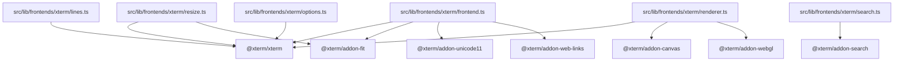

# 技术栈

Relevant source files

- package.json
- src/lib/frontendContext.ts
- src/lib/frontends/frontend.ts
- src/lib/frontends/xterm/frontend.ts
- src/lib/frontends/xterm/lines.ts
- src/lib/frontends/xterm/options.ts
- src/lib/frontends/xterm/renderer.ts
- src/lib/frontends/xterm/resize.ts
- src/lib/frontends/xterm/search.ts
- src/lib/frontends/xterm/support.ts
- src/lib/middleware/middleware.ts
- src/lib/middleware/oscProcessing.ts
- src/lib/motion/index.ts
- src/lib/utils.ts
- src/lib/workflowYaml.ts

本项目是一个基于 **Tauri 2 + Vue 3 + TypeScript** 的桌面应用：前端以 ESM 模块形式组织，由 [vite.config.ts](vite.config.ts) 中的 Vite 配置驱动构建，包管理使用 bun；Rust 侧通过 Cargo 声明 Tauri 运行时与一批原生能力 crate，形成「Vue 前端 + Rust 后端」的双栈结构。

前端技术栈呈现出三条清晰的主线：**终端渲染内核**（`@xterm/*` 系列，集中在 `src/lib/frontends/xterm/` 目录下的分层文件）、**UI 与国际化**（Vue 3、vue-i18n、reka-ui、lucide-vue-next、Tailwind 生态）、以及**状态与数据流**（pinia 管理 stores、rxjs 承担底层流式抽象）。Rust 侧则围绕 SSH/SFTP、PTY、加密与本地存储展开，与前端通过 Tauri 插件一一对应。

---

## 核心依赖

### 桌面容器与 Tauri 插件

前端通过以下包访问 Tauri 的宿主能力，其中多数在 Rust 侧存在同名对应插件（见 [Rust 依赖栈](#rust-依赖栈)）。

| 依赖 | 版本 | 首个 import 点 |
| --- | --- | --- |
| @tauri-apps/api | ^2.11.1 | src/components/settings/pages/AboutPage.vue |
| @tauri-apps/plugin-clipboard-manager | ^2.3.3 | src/lib/frontendContext.ts |
| @tauri-apps/plugin-dialog | ^2.7.3 | src/components/settings/pages/AppearancePage.vue |
| @tauri-apps/plugin-notification | ^2.4.0 | src/services/notifications.ts |
| @tauri-apps/plugin-opener | ^2.5.5 | src/components/settings/pages/AboutPage.vue |
| @tauri-apps/plugin-process | ^2.3.1 | src/services/updater.ts |
| @tauri-apps/plugin-updater | ^2.11.0 | src/components/settings/pages/AboutPage.vue |

这组依赖构成了应用与操作系统交互的边界。`@tauri-apps/api` 的引用面最广（设置页、SFTP 页、终端支持模块与 [src/main.ts](src/main.ts)），是全局性的宿主接口入口；其余插件则按能力收敛到具体模块：剪贴板能力集中在 [src/lib/frontendContext.ts](src/lib/frontendContext.ts)，通知能力集中在 [src/services/notifications.ts](src/services/notifications.ts)，更新相关能力分布在 [src/services/updater.ts](src/services/updater.ts)（同时引用 updater 与 process）与设置页。文件对话框能力出现于设置页、SFTP 面板与 [src/services/workflowYamlIo.ts](src/services/workflowYamlIo.ts)，说明导入导出类操作复用了统一的原生文件选择。

值得注意的是，updater / process / dialog / notification / opener / clipboard-manager 这六个插件在 `coreDeps` 与 Rust 侧 crate 中**同名单侧成对出现**，构成完整的「前端调用 — Rust 实现」链路；升级时应保持两侧同步。

### 终端渲染内核（xterm 家族）

| 依赖 | 版本 | 首个 import 点 |
| --- | --- | --- |
| @xterm/xterm | 5.5.0 | src/lib/frontends/xterm/frontend.ts |
| @xterm/addon-canvas | 0.6.0 | src/lib/frontends/xterm/renderer.ts |
| @xterm/addon-fit | 0.10.0 | src/lib/frontends/xterm/frontend.ts |
| @xterm/addon-search | 0.15.0 | src/lib/frontends/xterm/search.ts |
| @xterm/addon-unicode11 | 0.8.0 | src/lib/frontends/xterm/frontend.ts |
| @xterm/addon-web-links | ^0.12.0 | src/lib/frontends/xterm/frontend.ts |
| @xterm/addon-webgl | 0.18.0 | src/lib/frontends/xterm/renderer.ts |

这是全项目版本最"钉死"的一组依赖——除 web-links 外均使用精确版本号，说明终端行为对上游补丁版本敏感。选型上采用「核心 + 插件」模式：核心 `@xterm/xterm` 被 [src/lib/frontends/xterm/frontend.ts](src/lib/frontends/xterm/frontend.ts)、[lines.ts](src/lib/frontends/xterm/lines.ts)、[options.ts](src/lib/frontends/xterm/options.ts)、[renderer.ts](src/lib/frontends/xterm/renderer.ts)、[resize.ts](src/lib/frontends/xterm/resize.ts) 五处引用，而各 addon 按职责单一挂载：

- 适配与尺寸：`addon-fit` 同时被 [frontend.ts](src/lib/frontends/xterm/frontend.ts) 与 [resize.ts](src/lib/frontends/xterm/resize.ts) 引用，暗示尺寸计算被独立成模块。
- 渲染后端：`addon-canvas` 与 `addon-webgl` 都只出现在 [renderer.ts](src/lib/frontends/xterm/renderer.ts)，两种渲染器在此文件中收敛，便于切换。
- 文本能力：`addon-search` 单独落在 [search.ts](src/lib/frontends/xterm/search.ts)；`addon-unicode11` 与 `addon-web-links` 落在 [frontend.ts](src/lib/frontends/xterm/frontend.ts)。

依赖关系如图（节点均为数据中真实存在的文件与包）：

### UI 框架、组件与样式

| 依赖 | 版本 | 首个 import 点 |
| --- | --- | --- |
| vue | ^3.5.42 | src/App.vue |
| vue-i18n | ^11.4.10 | src/App.vue |
| reka-ui | ^2.10.4 | src/components/ui/Label.vue |
| lucide-vue-next | ^1.0.0 | src/components/forwarding/ForwardRuleFormDialog.vue |
| class-variance-authority | ^0.7.1 | src/components/ui/Button.vue |
| clsx | ^2.1.1 | src/lib/utils.ts |
| tailwind-merge | ^3.6.0 | src/lib/utils.ts |
| tw-animate-css | ^1.4.0 | src/main.ts |

Vue 3 是视图层基座，`vue-i18n` 紧随其后（同样在 [src/App.vue](src/App.vue) 引入，并广泛出现在转发、监控、命令面板等组件中），说明国际化在根组件即被装配。`reka-ui` 作为无样式组件原语，只在 `src/components/ui/` 下的基础组件（Label、Separator、Slider、Switch）中被引用，符合"原子组件层封装第三方原语、业务组件不直接触碰"的分层约定。

样式方案是典型的 Tailwind 工具链组合：`clsx` 与 `tailwind-merge` 共用同一个入口 [src/lib/utils.ts](src/lib/utils.ts)，负责类名拼接与冲突消解；`class-variance-authority` 在 [src/components/ui/Button.vue](src/components/ui/Button.vue) 中承担变体声明；`tw-animate-css` 在 [src/main.ts](src/main.ts) 引入（推断：作为全局动画样式入口，依据是其为 CSS 类库且在应用入口而非组件中被引用）。图标统一由 `lucide-vue-next` 提供，引用面覆盖转发、监控、设置等多类组件。

### 状态管理与响应式数据流

| 依赖 | 版本 | 首个 import 点 |
| --- | --- | --- |
| pinia | ^4.0.3 | src/main.ts |
| rxjs | ^7.8.2 | src/lib/frontends/frontend.ts |

两者分工明确。`pinia` 在 [src/main.ts](src/main.ts) 注册，并在 `src/stores/` 下的 config 仓库、[forwarding.ts](src/stores/forwarding.ts)、[monitor.ts](src/stores/monitor.ts)、[tabs.ts](src/stores/tabs.ts) 等模块中使用，是应用级状态容器；`rxjs` 则完全不进入 stores，而是集中在终端与中间件底层——[src/lib/frontends/frontend.ts](src/lib/frontends/frontend.ts)、[src/lib/frontends/xterm/frontend.ts](src/lib/frontends/xterm/frontend.ts)、[src/lib/frontends/xterm/support.ts](src/lib/frontends/xterm/support.ts)、[src/lib/middleware/middleware.ts](src/lib/middleware/middleware.ts)、[src/lib/middleware/oscProcessing.ts](src/lib/middleware/oscProcessing.ts)。

这种分布表明架构上存在清晰分界：**UI/业务状态用 pinia，字节流与终端事件处理用 rxjs**。`src/lib/middleware/` 与 `src/lib/frontends/` 两层均依赖 rxjs，是终端数据管道的公共抽象层。

### 通用工具库

| 依赖 | 版本 | 首个 import 点 |
| --- | --- | --- |
| gsap | ^3.15.0 | src/lib/motion/index.ts |
| nanoid | ^6.0.1 | src/components/settings/pages/KeysPage.vue |
| yaml | ^2.9.1 | src/lib/workflowYaml.ts |
| deep-equal | ^2.2.3 | src/lib/frontends/xterm/frontend.ts |

- **gsap**：引入动机有提交证据——`feat: 引入GSAP优化部分动画过渡`（commit:5039d5de，2026-09-27），即用于动画过渡效果的优化。其唯一引用点是 [src/lib/motion/index.ts](src/lib/motion/index.ts)，说明动画能力被封装成统一的 motion 层对外提供。
- **nanoid**：散布在多个设置页（Keys、LocalProfiles、QuickCommands、Ssh、TabGroups）中，用于为新建配置项生成标识。
- **yaml**：仅在 [src/lib/workflowYaml.ts](src/lib/workflowYaml.ts) 与 [src/stores/config/store.ts](src/stores/config/store.ts) 使用，前者是 YAML 读写逻辑的归属处，后者是配置状态的持久化侧。
- **deep-equal**：只出现在 [src/lib/frontends/xterm/frontend.ts](src/lib/frontends/xterm/frontend.ts)，用于终端相关对象的深层比较。

---

## 开发依赖

| 依赖 | 版本 | 首个 import 点 | 开发场景 |
| --- | --- | --- | --- |
| vite | ^8.3.0 | vite.config.ts | 开发服务器与生产构建 |
| @vitejs/plugin-vue | ^6.0.8 | vite.config.ts | Vue 单文件组件编译 |
| @tailwindcss/vite | ^4.3.3 | vite.config.ts | Tailwind v4 的 Vite 集成 |
| tailwindcss | ^4.3.3 | src/assets/styles/main.css | 原子化样式引擎 |
| oxlint | ^1.82.0 | —（由 npm 脚本调用） | 代码静态检查 |
| vue-tsc | ^3.3.11 | —（由 npm 脚本调用） | Vue 类型检查 |

构建侧以 [vite.config.ts](vite.config.ts) 为唯一装配点，Vite、Vue 插件与 Tailwind Vite 插件三者在此汇合，说明构建配置集中而非分散。`tailwindcss` 本体则通过样式入口 [src/assets/styles/main.css](src/assets/styles/main.css) 引入，与 `@tailwindcss/vite` 插件的构建期集成形成「配置 + 样式入口」的双点接入。`oxlint` 与 `vue-tsc` 没有源码 import 点、仅通过脚本调用，属于纯命令行工具链。

需要注意：Tailwind 虽然列在开发依赖中，但其样式产物会进入生产包（[src/assets/styles/main.css](src/assets/styles/main.css) 被应用样式链路引用），并非仅供开发期使用。

---

## 测试专用依赖

| 依赖 | 版本 | 首个测试 import 点 |
| --- | --- | --- |
| vitest | ^5.0.0 | src/components/settings/groupDragSort.test.ts |

项目仅配置了 vitest 一个测试运行器，测试文件与源码同位放置（设置、分屏、终端搜索、标题栏布局等模块旁），表明测试策略以模块级单元测试为主。**vitest 不属于生产运行时技术栈**，不会被打进应用产物，升级它只影响测试执行环境。

---

## Rust 依赖栈

Rust 侧（Cargo.toml）声明了 30 个 crate，全部检出被引用。

| crate | 版本 | 使用 |
| --- | --- | --- |
| tauri | 2 | 应用运行时与命令桥接 |
| tauri-build | 2 | 构建脚本依赖 |
| tauri-plugin-opener | 2 | 打开外部链接/文件，对应前端 @tauri-apps/plugin-opener |
| tauri-plugin-clipboard-manager | 2 | 剪贴板读写，对应前端 @tauri-apps/plugin-clipboard-manager |
| tauri-plugin-dialog | 2.7.3 | 原生文件对话框，对应前端 @tauri-apps/plugin-dialog |
| tauri-plugin-notification | 2 | 系统通知，对应前端 @tauri-apps/plugin-notification |
| tauri-plugin-updater | 2 | 应用自更新，对应前端 @tauri-apps/plugin-updater |
| tauri-plugin-process | 2 | 进程重启/退出，对应前端 @tauri-apps/plugin-process |
| serde | 1 | 数据结构序列化/反序列化 |
| serde_json | 1 | JSON 编解码 |
| portable-pty | 0.9 | 跨平台伪终端（PTY） |
| tokio | 1 | 异步运行时 |
| uuid | 1 | UUID 生成 |
| chrono | 0.4 | 日期时间处理 |
| window-vibrancy | 0.6 | 窗口透明/毛玻璃效果 |
| font-loader | 0.11.0 | 字体加载 |
| russh | 0.63.3 | SSH 协议实现 |
| russh-sftp | 3.0.0 | SFTP 协议实现 |
| rusqlite | 0.40.2 | SQLite 本地存储 |
| aes-gcm | 0.11.1 | AES-GCM 对称加密 |
| argon2 | 0.5 | Argon2 口令哈希 |
| keyring | 4.2.0 | 系统密钥链访问 |
| getrandom | 0.3 | 随机数源 |
| base64 | 0.22 | Base64 编解码 |
| sha2 | 0.10 | SHA-2 摘要 |
| hmac | 0.12 | HMAC 消息认证码 |
| reqwest | 0.13 | HTTP 客户端 |
| fast-socks5 | 1.0 | SOCKS5 代理 |
| roxmltree | 0.20 | XML 只读解析 |

从分组看，Rust 侧能力可归为四类：

1. **Tauri 框架与插件层**：`tauri`、`tauri-build` 与六个 `tauri-plugin-*`，其中插件部分与前端 `@tauri-apps/plugin-*` 一一对应，构成前后端能力通道。升级 Tauri 主版本时，这一整组需要联动。
2. **终端与网络**：`portable-pty` 提供伪终端，`russh` / `russh-sftp` 提供 SSH 与 SFTP 协议，`fast-socks5` 提供代理支持，`tokio` 作为其异步底座，`reqwest` 负责 HTTP 出口。
3. **安全与凭据**：`aes-gcm`（对称加密）、`argon2`（口令哈希）、`keyring`（系统密钥链）、`sha2` / `hmac`（摘要与认证）、`getrandom`（随机源）、`base64`（编码）共同构成加密与凭据存取栈。
4. **数据与平台适配**：`rusqlite` 承担本地持久化，`serde` / `serde_json` 负责跨语言数据传输，`uuid` / `chrono` 提供标识与时间，`window-vibrancy` / `font-loader` 负责窗口外观与字体，`roxmltree` 用于 XML 解析。

---

## 声明未用依赖

> 下表由源码 import 扫描推导（覆盖 .ts/.js/.vue/.css），存在动态加载、字符串引用等扫描盲区，清理前请人工复核。

| 依赖 | 版本 |
| --- | --- |
| @tauri-apps/cli | ^2.11.4 |
| @types/deep-equal | ^1.0.4 |
| @types/node | ^22.20.2 |
| typescript | ~5.9.0 |

这四项未被扫描认定为源码 import 点，但均属典型的**工具链与类型声明类包**：`@tauri-apps/cli` 与 `typescript` 一般通过命令行/脚本方式调用，`@types/*` 则通过 TypeScript 的类型解析机制生效——这类使用方式天然不会出现在 `import` 语句中。因此**不能据此断定它们无用**，移除前需确认其在脚本与类型配置中的实际作用。

---

## 待确认

- **包管理器 bun 的证据锚点**：数据给出包管理器为 bun，但未提供锁文件或相关配置文件的路径锚点，无法从源码侧验证。
- **Rust 侧各 crate 的具体调用点**：本节仅能确认 Cargo.toml 中的声明与"检出被引用"状态，数据未提供 Rust 源码中的调用位置，因此各 crate 的职责描述基于 crate 名称，未逐一锚定到调用代码。
- **oxlint / vue-tsc / typescript 的脚本定义位置**：数据中这三者标注为脚本调用，但未给出 `package.json` 中的具体命令锚点，无法展示实际执行方式。
## Related

- 同目录：[overview.md](overview.md) · [environment.md](environment.md)
- 互补职责：[overview.md](../01-overview/overview.md)
- 共享 6 个源文件、共享 25 个符号：[onboarding.md](../05-guides/onboarding.md)
- 共享 8 个源文件、共享 12 个符号：[troubleshooting.md](../05-guides/troubleshooting.md)
- 共享 3 个源文件、共享 2 个符号：[constraints.md](../06-constraints/constraints.md)
- 总入口：[README](../README.md)

<!-- wiki:source: llm -->
