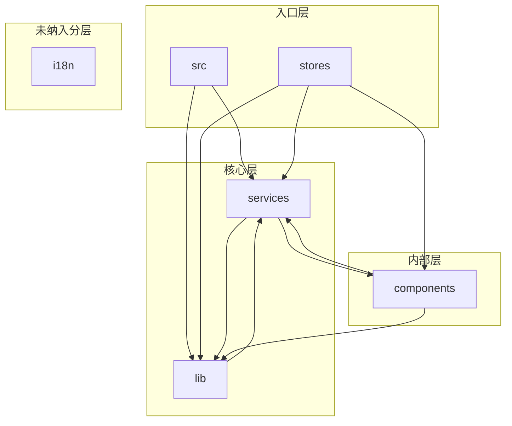
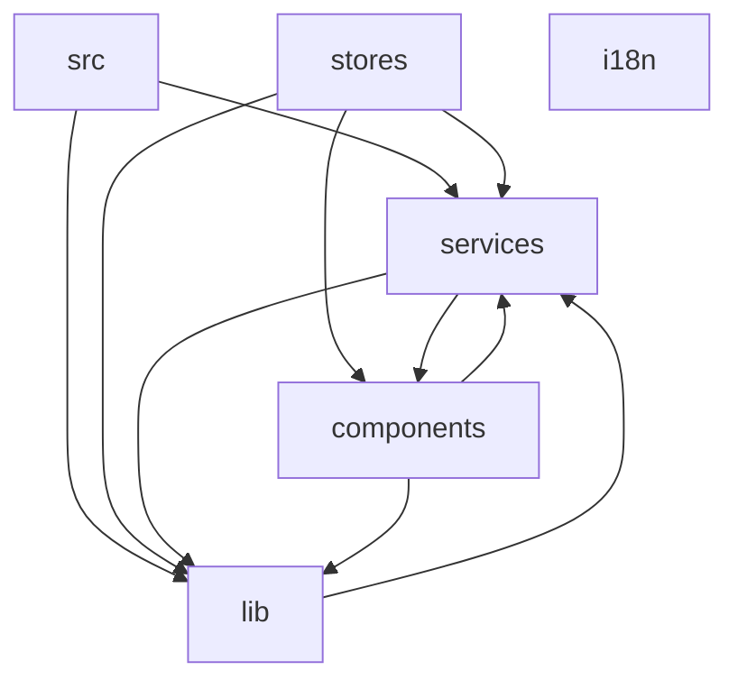

Relevant source files

- src-tauri/src/background.rs
- src-tauri/src/config/groups.rs
- src-tauri/src/config/legacy.rs
- src-tauri/src/config/load.rs
- src-tauri/src/config/mod.rs
- src-tauri/src/config/model.rs
- src-tauri/src/config/profiles.rs
- src/i18n/en.ts
- src/i18n/en/panels.ts
- src/i18n/en/settings.ts
- src/i18n/index.ts
- src/i18n/zh-CN.ts
- src/i18n/zh/panels.ts
- src/i18n/zh/settings.ts
- src/lib/backgroundImage.ts

## 整体架构设计思路与架构图

从顶层目录看，项目由 6 个模块组成：`src`（60 个文件）、`lib`（51 个）、`services`（29 个）、`components`（75 个）、`stores`（10 个）、`i18n`（7 个）。按依赖形态，数据把其中 5 个模块划入三层：`src` 与 `stores` 归为**入口层**（判定依据是它们只存在对外调用、没有入向依赖）；`lib` 与 `services` 归为**核心层**（被依赖规模分别达 57 处 / 40 处，对外依赖 22 处 / 38 处）；`components` 归为**内部层**（被依赖 5 处，对外依赖 11 处）。`i18n` 未被纳入分层，数据中也没有它的任何依赖边。

| 模块 | 所属层 | 分层依据 | 文件数 |
| --- | --- | --- | --- |
| `src` | 入口层 | 含入口点，仅有对外调用 | 60 |
| `stores` | 入口层 | 仅有对外调用 | 10 |
| `lib` | 核心层 | 被依赖 57 处、对外依赖 22 处 | 51 |
| `services` | 核心层 | 被依赖 40 处、对外依赖 38 处 | 29 |
| `components` | 内部层 | 被依赖 5 处、对外依赖 11 处 | 75 |
| `i18n` | 未纳入分层 | 数据未给出分层，亦无依赖边 | 7 |

层间协作并非逐层下钻，而是「入口层按需直达下层」。`src` 同时连到核心层的两个模块（`src → lib`、`src → services`），`stores` 则同时连到核心层与内部层（`stores → lib`、`stores → services`、`stores → components`），跨越了两层。核心层内部也不是单向的：`services` 与 `lib` 互为调用（`services → lib`、`lib → services`），核心层与内部层同样互指（`services → components`、`components → services`）。因此整体骨架是分层的，但局部存在双向耦合对，实际形态更接近「分层 + 共享核心 + 组件库」的混合风格，而非严格单向分层。

| 调用方 | 被调用方 | 证据 | 是否跨层 |
| --- | --- | --- | --- |
| `src` | `services` | `src → services` | 入口层 → 核心层 |
| `src` | `lib` | `src → lib` | 入口层 → 核心层 |
| `stores` | `lib` | `stores → lib` | 入口层 → 核心层 |
| `stores` | `services` | `stores → services` | 入口层 → 核心层 |
| `stores` | `components` | `stores → components` | 入口层 → 内部层（跨两层） |
| `services` | `lib` | `services → lib` | 核心层内部 |
| `lib` | `services` | `lib → services` | 核心层内部（反向） |
| `services` | `components` | `services → components` | 核心层 → 内部层 |
| `components` | `services` | `components → services` | 内部层 → 核心层（反向） |
| `components` | `lib` | `components → lib` | 内部层 → 核心层 |

代码的实际聚簇与模块划分并不一一对应。数据给出 12 个高内聚代码群，标签为 `src-tauri` 的 6 个群规模分别为 112、72、55、49、42、33 个成员，例如包含 `execute`、`lock_conn`、`mark_initialized`（内聚度 0.856），以及 `ssh_connect`、`forward_start`、`session`、`snapshot`、`stop`（内聚度 0.822）——后者从符号命名看涉及连接与转发类能力，但本节不展开其内部实现。标签为 `src` 的群组内聚度更高，如 `load` / `flush` / `migrateLocalGroups`（内聚度 1.0）、`onSilence` / `evaluate` / `acceptSelected`（0.977）、`constructor` / `encodeUTF8` / `refreshMirror`（0.965），集中体现了状态管理与交互逻辑的聚合方式。这意味着项目的模块目录只提供粗粒度边界，真正的职责切分体现在这些符号簇上。

**待确认**：模块清单中不存在 `src-tauri`，但聚簇标签中出现了 6 个 `src-tauri` 群组，其与现有模块的归属关系缺少证据。**待确认**：`i18n` 既未被分层，也没有任何依赖边，它如何被其他模块接入（或是否完全独立）缺少证据。

**推断**：`src-tauri` 群组下的代表符号多为 `execute`、`lock_conn`、`load_internal`、`ssh_connect`、`forward_start` 一类下划线命名，与 `src` 群组中的 `onSilence`、`computeSuggestions`、`refreshMirror` 等驼峰命名分属两套风格，推断这两类代码来自不同的语言或运行时边界；依据仅为聚簇标签与符号命名特征，数据中无编译产物、构建配置或目录路径佐证。

## 核心模块详解

本节逐一说明本批次六个核心模块的职责、语言构成、设计意图与依赖关系。所有事实性描述均附源码锚点；模块级符号明细（符号签名与逐个用途）因数据缺失统一列入「待确认」。

---

### 1. src 模块（src-tauri/src）

`src` 是 Tauri 应用的后端实现层，共 60 个文件，其中 Rust 55 个、TypeScript 3 个、其他 2 个。Rust 代码承载核心系统能力：SFTP 传输调度、敏感数据加密存储、SSH 端口转发、文件系统工具命令、命令历史持久化。该模块依赖 `services` 与 `lib` 两个前端模块，数据中未记录有模块依赖它。

**语言构成与职责域**

- **Rust（55 文件）**：后端命令实现与系统能力。由文件头自述可确认的职责域包括传输任务中心、密钥加密存储、端口转发、文件系统工具、SFTP 面板后端、命令历史持久化（见表 1-1）。
- **TypeScript（3 文件）**：具体职责数据未给出来源证据，见「待确认」。
- **其他（2 文件）**：同上，数据无标注。

**表 1-1 设计意图（文件头自述）**

| 源码文件 | 文件头自述要点 | 锚点 |
|---|---|---|
| transfers/mod.rs | SFTP 传输任务中心：上传/下载统一注册进 TransferManager，任务快照经 app 级事件 `sftp-transfers-changed` 全量广播（进度按 ≥1MB 步进节流），支持取消（AtomicBool 标志注入传输循环）、暂停/继续/重试与目录递归传输；同一 SSH 连接内任务按 FIFO 排队、限并发执行（信号量）；断点续传以 `.scxpart` 部分文件实现 | src-tauri/src/transfers/mod.rs:1 |
| secrets/mod.rs | 敏感数据加密存储：SQLite（secrets.db）+ AES-256-GCM 字段级加密，主密钥随机生成存 macOS 钥匙串（keyring，service `scx-terminal`/user `master-key`），密文格式 = 12 字节随机 nonce 前置 + 密文（含 GCM tag） | src-tauri/src/secrets/mod.rs:1 |
| forward/mod.rs | SSH 端口转发后端：本地转发（-L，本地 TcpListener → direct-tcpip channel）、远程转发（-R，tcpip_forward 请求 server 监听 → 入站 channel 回连本地目标）、动态转发（-D，fast-socks5 no-auth CONNECT → direct-tcpip channel） | src-tauri/src/forward/mod.rs:1 |
| fsutil.rs | 文件系统工具命令：路径补全的列目录与 shell history 文件读取，以及 SFTP 本地栏目录浏览；补全命令做 `~` → $HOME 展开，列目录错误静默降级返回空数组，浏览命令错误显式返回 Err | src-tauri/src/fsutil.rs:1 |
| sftp.rs | SFTP 文件面板后端：在同一 russh 连接上开第二 channel 跑 `sftp` subsystem（russh-sftp 3.0）；上传/下载经 transfers 模块的 TransferManager 执行 | src-tauri/src/sftp.rs:1 |
| history.rs | 命令历史持久化：SQLite（history.db，独立于 config.db——历史是高频写数据不属于配置语义）；沿用 config.rs 的「Mutex 单连接 + WAL + PRAGMA user_version 迁移」模式；同 source 同命令去重存储，导入经 meta 表 `imported:{source}` 标记幂等 | src-tauri/src/history.rs:1 |

**设计意图说明**：这几份文件头自述显示一致的架构取向——把「长生命周期资源」（SSH 连接、SQLite 连接、主密钥）集中托管，把跨切面行为（进度广播、加密、错误降级策略）收敛到单一模块内。例如 transfers 模块将取消、暂停/重试、递归统计、断点续传统一在任务中心内编排（src-tauri/src/transfers/mod.rs:1）；sftp.rs 明确「上传/下载经 transfers 模块的 TransferManager 执行」，说明文件面板与传输调度是分层而非并列关系（src-tauri/src/sftp.rs:1）；history.rs 明确将历史库与配置库分离，理由是「历史是高频写数据不属于配置语义」（src-tauri/src/history.rs:1）。

**依赖关系**

| 方向 | 模块 |
|---|---|
| 依赖 | services、lib |
| 被依赖 | 无记录 |

---

### 2. lib 模块（src/lib）

`lib` 是前端的纯逻辑层，共 51 个文件，其中 TypeScript 50 个、其他 1 个。它被 `services`、`stores`、`components`、`src` 四个模块依赖，自身仅依赖 `services`，是整个前端被引用面最广、复用度最高的模块。多份文件头自述明确其设计准则为「纯逻辑 + IO 全注入 / UI 无关」，以便单测。

**语言构成与职责域**

- **TypeScript（50 文件）**：无 UI 依赖的业务纯逻辑——输入行建模与补全建议、监控编排、起始页视图构建、终端配色、端口转发规则模型等（见表 2-1）。
- **其他（1 文件）**：数据未标注，见「待确认」。

**表 2-1 设计意图（文件头自述）**

| 源码文件 | 文件头自述要点 | 锚点 |
|---|---|---|
| suggestions/promptTracker.ts | 输入行模型：从 xterm buffer 现读现算当前逻辑行（soft-wrap 链拼接）、提示符剥离、续行合并、词定位；PromptTracker 在此之上做提示符长度自适应学习与回车命令采集；对 shell 端编辑（Tab 补全/↑ 调历史/Ctrl+R）免疫——永不维护影子副本 | src/lib/suggestions/promptTracker.ts:1 |
| suggestions/controller.ts | 建议控制器：聚合 PromptTracker（输入行模型 + 提示符学习 + 命令采集）、建议引擎与菜单 UI 状态；菜单键盘语义（↑↓/Tab/Enter/→/Esc）、接受写入（公共前缀保留 + 退格差异）、Esc 抑制自动弹出、历史记录写入 | src/lib/suggestions/controller.ts:1 |
| monitorOrchestrator.ts | SSH 监控编排器（纯逻辑，IO 全注入）：管理档案级的卡片/详情两级采样绑定，经注册表消费计数管理连接生命周期；fatal 后按退避序列重连（release → acquire → start），成功即重置退避 | src/lib/monitorOrchestrator.ts:1 |
| startPage.ts | 连接中心（起始页）纯逻辑：SSH 档案分组视图构建、本地终端分组过滤、全局搜索过滤、最近连接排序与相对时间分桶；UI 无关，便于单测 | src/lib/startPage.ts:1 |
| colorSchemes.ts | 内置终端配色方案库：严格复刻 Tabby 候选主题列表——Tabby Default / Tabby Default Light 两套核心默认配色（移植自 tabby-terminal colorSchemes.ts，保留选区增强值）+ Tabby 官方社区配色全集（communityColorSchemes.ts，189 套）；并提供按用户偏好解析配色的工具函数 | src/lib/colorSchemes.ts:1 |
| portForwarding.ts | 端口转发纯逻辑层：转发类型与数据模型（档案持久化规则 + 运行态）、规则归一化校验（sanitize，config 加载时清洗）、展示文案、autoStart 规则筛选与规则 → 启动参数映射；IPC 封装见 services/forward.ts | src/lib/portForwarding.ts:1 |

**设计意图说明**：`lib` 的多份自述反复强调同一模式——**把可测性放在首位**：`startPage.ts` 直言「UI 无关，便于单测」（src/lib/startPage.ts:1）；`monitorOrchestrator.ts` 标注「纯逻辑，IO 全注入」（src/lib/monitorOrchestrator.ts:1）；`portForwarding.ts` 把规则模型与 IPC 封装拆开，明确「IPC 封装见 services/forward.ts」（src/lib/portForwarding.ts:1）。`promptTracker.ts` 的「永不维护影子副本」是一条防止状态不一致的关键约束（src/lib/suggestions/promptTracker.ts:1）。`colorSchemes.ts` 的意图则是兼容性移植而非重新设计（src/lib/colorSchemes.ts:1）。

**依赖关系**

| 方向 | 模块 |
|---|---|
| 依赖 | services |
| 被依赖 | services、stores、components、src |

---

### 3. services 模块（src/services）

`services` 是前端与后端之间的接线层，共 29 个文件，全部为 TypeScript。它依赖 `lib` 与 `components`，同时被 `lib`、`src`、`stores`、`components` 依赖，处于前端依赖图的中枢位置。该模块的职责是把 `lib` 层的纯逻辑接到真实 IO（Tauri IPC、事件通道、系统通知）上。

**语言构成与职责域**

- **TypeScript（29 文件）**：Tauri IPC 封装、Rust SSH 会话句柄、连接注册表、系统通知、自动更新、背景图应用等（见表 3-1）。

**表 3-1 设计意图（文件头自述）**

| 源码文件 | 文件头自述要点 | 锚点 |
|---|---|---|
| tabSession.ts | 标签恢复快照：形状守卫（库内 JSON 是系统边界，须校验）+ 启动加载 + 变更防抖同步；快照 schema v1：`{ version: 1, entries: [{ groupId, tabs: [{ profileId?, manualTitle?, color? }] }] }` | src/services/tabSession.ts:1 |
| ssh.ts | Rust SSH 会话（russh）的前端句柄：连接选项、二进制输出通道（带 ack 背压与订阅前缓冲）、exit/close/hostkey 事件监听与指纹确认应答；结构对照 services/pty.ts 的 TauriPTYProxy（Tauri IPC 数据面约定一致）；支持 kbd-interactive 凭据挑战事件与应答 | src/services/ssh.ts:1 |
| notifications.ts | 后台标签响铃的系统通知服务：读外观分片开关、按标签节流（BEL 常连续触发）、权限拒绝时静默降级为仅标签未读标记 | src/services/notifications.ts:1 |
| sshConnections.ts | SSH 连接注册表服务：SshConnectionRegistry 的 IO 接线——headless 建连走 SshProxy（hostkey 确认经全局 pendingHostKey 供 App 层对话框呈现）、断连走 ssh_kill；维护档案级连接状态的 reactive 镜像；registryVersion 在任何连接集合变化时自增，供组件 watch | src/services/sshConnections.ts:1 |
| updater.ts | 自动更新服务（仅手动检查）：check 的三条路径透传给调用方，安装流程聚合下载进度并在成功后重启应用（失败不重启） | src/services/updater.ts:1 |
| backgroundImage.ts | 终端背景图片应用服务：从 Rust 读回图片 bytes 转 blob URL 写入全局 CSS 变量（--term-bg-*），TerminalPane 背景层消费；模块级持有 objectURL，替换时 revoke；无图/读失败降级为 none | src/services/backgroundImage.ts:1 |

**设计意图说明**：`services` 层的自述共同点是**显式处理失败与降级**：`notifications.ts` 在权限被拒时「静默降级为仅标签未读标记」（src/services/notifications.ts:1）；`backgroundImage.ts` 在「无图/读失败降级为 none」（src/services/backgroundImage.ts:1）；`updater.ts` 明确「成功后重启应用（失败不重启）」（src/services/updater.ts:1）。另一条主线是**统一数据面约定**：`ssh.ts` 明确「结构对照 services/pty.ts 的 TauriPTYProxy（Tauri IPC 数据面约定一致）」，说明 HTTP/IPC 通道的背压与缓冲策略被刻意保持一致（src/services/ssh.ts:1）；`tabSession.ts` 则强调「库内 JSON 是系统边界，须校验」（src/services/tabSession.ts:1）。

**依赖关系**

| 方向 | 模块 |
|---|---|
| 依赖 | lib、components |
| 被依赖 | lib、src、stores、components |

---

### 4. components 模块（src/components）

`components` 是 UI 组件层，共 75 个文件，其中 TypeScript 68 个、其他 7 个，是本批次文件数最多的模块。它依赖 `lib` 与 `services`，被 `services` 与 `stores` 依赖。文件头自述显示出一种共同做法：把标签条、分组拖拽、标签切换器等交互中**可计算的规则抽出为纯函数/纯 model**，组件本体只做渲染。

**语言构成与职责域**

- **TypeScript（68 文件）**：Vue 组件与配套的纯计算工具（见表 4-1）。
- **其他（7 文件）**：数据未标注，见「待确认」。

**表 4-1 设计意图（文件头自述）**

| 源码文件 | 文件头自述要点 | 锚点 |
|---|---|---|
| settings/groupDragSort.ts | 分组指针拖拽的纯计算工具：从指针命中的元素反查分组头，供 Tauri 场景替代会被原生文件拖放拦截的 HTML5 Drag & Drop | src/components/settings/groupDragSort.ts:1 |
| titlebar/tabGroupLayout.ts | 标签分组展示序与拖拽换算的纯函数集：展示序 = 全部分组（定义序，含空组 chip）在前 + 未分组标签（数组序）在后；数组相对顺序只影响「同组内」与「未分组区」的先后 | src/components/titlebar/tabGroupLayout.ts:1 |
| settings/useDraftEditor.ts | 设置域共享的「草稿编辑器」：档案/SSH/快捷命令等编辑表单不再实时写入 config store，而是编辑条目的草稿副本，经「保存」按钮统一提交；存在未保存修改时切换条目/新建经确认弹窗放行（复用共享 confirmAction） | src/components/settings/useDraftEditor.ts:1 |
| settings/useConfirmAction.ts | 设置域共享的确认弹窗状态（模块级单例）：各设置页调用 confirmAction()，SettingsView 外壳统一渲染 Dialog，跨页共用一份；默认承接删除确认场景；title/confirmLabel 可选参数允许复用到「放弃未保存修改」等非删除场景 | src/components/settings/useConfirmAction.ts:1 |
| titlebar/tabSwitcherModel.ts | 标签页切换器的纯计算模型：统一处理 MRU 排序、分组过滤、模糊搜索与左侧分组过滤栏数据，避免组件内散落交互规则 | src/components/titlebar/tabSwitcherModel.ts:1 |
| titlebar/tabStripLayout.ts | 标签栏溢出布局的纯计算工具：把滚轮输入转换成横向滚动量，并计算能让活动标签完整可见的最小滚动位置 | src/components/titlebar/tabStripLayout.ts:1 |

**设计意图说明**：该模块的自述集中在两条设计意图。其一是**把交互规则从组件中抽出**：`tabSwitcherModel.ts` 明确目标是「避免组件内散落交互规则」（src/components/titlebar/tabSwitcherModel.ts:1），`tabGroupLayout.ts`、`tabStripLayout.ts`、`groupDragSort.ts` 同属这一模式（src/components/titlebar/tabGroupLayout.ts:1、src/components/titlebar/tabStripLayout.ts:1、src/components/settings/groupDragSort.ts:1）。其二是**设置域表单的提交语义改造**：`useDraftEditor.ts` 说明「不再实时写入 config store，而是编辑条目的草稿副本，经『保存』按钮统一提交」（src/components/settings/useDraftEditor.ts:1），`useConfirmAction.ts` 作为配套的单例确认弹窗，被设计为可复用到「放弃未保存修改」等非删除场景（src/components/settings/useConfirmAction.ts:1）。`groupDragSort.ts` 另记录了一条平台约束动因：Tauri 场景下 HTML5 Drag & Drop 会被原生文件拖放拦截，故改用指针计算（src/components/settings/groupDragSort.ts:1）。

**依赖关系**

| 方向 | 模块 |
|---|---|
| 依赖 | lib、services |
| 被依赖 | services、stores |

---

### 5. stores 模块（src/stores）

`stores` 是前端状态管理层，共 10 个文件，全部为 TypeScript。它依赖 `lib`、`services`、`components` 三个模块，数据中未记录有模块依赖它。该模块承担三类状态的持有：监控采样、应用配置（含落库）、端口转发运行态。其中配置子模块被拆成 defaults / store / flush / index 四块，形成「默认值与纯函数 → store 本体 → 差异 flush → 统一再导出」的分层。

**语言构成与职责域**

- **TypeScript（10 文件）**：全局 store 与配置持久化引擎（见表 5-1）。

**表 5-1 设计意图（文件头自述）**

| 源码文件 | 文件头自述要点 | 锚点 |
|---|---|---|
| monitor.ts | 全局监控 store：订阅 Rust monitor-* 事件维护每档案最新样本与 150 点环形缓冲；errors 用哨兵值（'unsupported' / 'reconnecting'）与原始错误文本，UI 侧按哨兵映射文案 | src/stores/monitor.ts:1 |
| config/defaults.ts | 配置默认值与纯函数助手：默认配置/热键、系统 shell 生成本地分组与档案、存量迁移、分组分段视图、最近记录 upsert 与 deepMerge | src/stores/config/defaults.ts:1 |
| config/store.ts | 配置 store 本体：响应式全量配置 + 深度 watch 防抖 flush 落库（调用方保持直接改 store 的用法）；加载时合并库内快照/legacy yaml、清理无效引用、按需生成默认档案与迁移本地分组 | src/stores/config/store.ts:1 |
| config/flush.ts | 差异 flush 引擎：把本地 store mutation 翻译成 Rust 侧实体级 CRUD 命令；基线 = 各实体键排序的稳定序列化快照；flush 只重试「当前状态与基线」的剩余差异，单条失败即中断且基线不动（部分成功可安全续传） | src/stores/config/flush.ts:1 |
| forwarding.ts | 端口转发运行态聚合 store：`forward_list_all` 全量拉取 + 按连接订阅 `forward:{sshId}:changed` 事件（连接集合来自 sshConnections 注册表，registryVersion 变化时同步增删订阅）；隧道管理器标签页与 TitleBar 隧道指示器的数据源 | src/stores/forwarding.ts:1 |
| config/index.ts | 配置 store 桶模块：对外保持 `@/stores/config` 的完整公开面不变（类型 / 默认值与纯函数 / flush 引擎 / store 本体统一再导出） | src/stores/config/index.ts:1 |

**设计意图说明**：`stores` 的自述体现出两条明确原则。第一是**状态与落库解耦且可续传**：`config/store.ts` 保留「调用方保持直接改 store 的用法」，由深度 watch 防抖 flush 承担落库（src/stores/config/store.ts:1）；`config/flush.ts` 进一步说明 flush 是差异式的，且「单条失败即中断且基线不动（部分成功可安全续传）」，这是把网络/IPC 部分失败纳入设计的前提假设（src/stores/config/flush.ts:1）。第二是**订阅集合跟随连接集合动态增删**：`forwarding.ts` 依据 sshConnections 注册表的 registryVersion 变化同步增删事件订阅（src/stores/forwarding.ts:1）。此外 `monitor.ts` 用哨兵值区分「不支持」与「重连中」两类非正常态，把文案映射交给 UI（src/stores/monitor.ts:1）。

**依赖关系**

| 方向 | 模块 |
|---|---|
| 依赖 | lib、services、components |
| 被依赖 | 无记录 |

---

### 6. i18n 模块（src/i18n）

`i18n` 是国际化词条与装配模块，共 7 个文件，全部为 TypeScript。数据中未记录它依赖任何模块，也未被任何模块依赖。结构上按「语言 × 领域」二维切分：语言为 en / zh-CN，领域为 settings（设置域）与 panels（面板域），由 `index.ts` 装配、由 `zh-CN.ts` 做浅合并。

**语言构成与职责域**

- **TypeScript（7 文件）**：vue-i18n 装配、双语词条包与语言包合并（见表 6-1）。

**表 6-1 设计意图（文件头自述）**

| 源码文件 | 文件头自述要点 | 锚点 |
|---|---|---|
| index.ts | vue-i18n 装配入口：语言包在 zh-CN.ts / en.ts（Messages 类型以 zh-CN 为基准） | src/i18n/index.ts:1 |
| en/settings.ts | English 设置域词条（settings 子树整体） | src/i18n/en/settings.ts:1 |
| zh/settings.ts | 简体中文设置域词条（settings 子树整体） | src/i18n/zh/settings.ts:1 |
| zh/panels.ts | 简体中文面板域词条（sftp/传输/转发/SSH/命令/面板/搜索/终端/标签/起始页/监控） | src/i18n/zh/panels.ts:1 |
| en/panels.ts | English 面板域词条（sftp/传输/转发/SSH/命令/面板/搜索/终端/标签/起始页/监控） | src/i18n/en/panels.ts:1 |
| zh-CN.ts | 简体中文语言包装配：设置域（settings）+ 面板域（panels）浅合并；键结构是 en 与类型 Messages 的基准 | src/i18n/zh-CN.ts:1 |

**设计意图说明**：`index.ts` 声明「Messages 类型以 zh-CN 为基准」（src/i18n/index.ts:1），`zh-CN.ts` 声明「键结构是 en 与类型 Messages 的基准」（src/i18n/zh-CN.ts:1），两处一致地确立了**中文为词条键结构的事实源**，英文包需对齐该结构。`zh-CN.ts` 采用「设置域 + 面板域浅合并」的组装方式（src/i18n/zh-CN.ts:1），对应 `zh/settings.ts`、`zh/panels.ts` 的领域切分（src/i18n/zh/settings.ts:1、src/i18n/zh/panels.ts:1）；panels 域覆盖 sftp/传输/转发/SSH/命令/面板/搜索/终端/标签/起始页/监控共十一个子域（src/i18n/zh/panels.ts:1）。

**依赖关系**

| 方向 | 模块 |
|---|---|
| 依赖 | 无记录 |
| 被依赖 | 无记录 |

---

### 模块依赖一览

下表汇总本批次六个模块的依赖与被依赖关系（依据各模块的依赖清单字段）。由于所有模块的扇入、扇出计数在数据中均为 0，位置重要性的量化排序无法给出，故仅以依赖边呈现结构。

| 模块 | 文件数 | 依赖 | 被依赖 |
|---|---|---|---|
| src | 60 | services、lib | 无记录 |
| lib | 51 | services | services、stores、components、src |
| services | 29 | lib、components | lib、src、stores、components |
| components | 75 | lib、services | services、stores |
| stores | 10 | lib、services、components | 无记录 |
| i18n | 7 | 无记录 | 无记录 |

依赖边中值得注意的三点：`lib` 的被依赖面最广（被四个模块引用），说明纯逻辑层是前端的复用底座；`services` 与 `components` 之间存在**双向依赖**（services 依赖 components，components 依赖 services）；`i18n` 在本批次数据中没有入边也没有出边，其词条如何被消费未在依赖数据中体现。

---

### 待确认

1. **模内符号明细缺失**：六个模块的符号数均为 0，`topSymbols`（待确认） 全为空数组（仅提供模块与文件级锚点）。因此无法逐一说明各模块的顶层符号、函数签名与 docstring 内容，本节的设计意图仅能基于文件头自述展开。
2. **src 模块的 TypeScript 与「其他」文件未标注职责**：src 含 TypeScript 3 个、其他 2 个文件（src-tauri/src 下），数据未给出这些文件的路径与用途，其职责域无法分语言说明。
3. **lib 与 components 的「其他」类文件未标注**：lib 含其他 1 个、components 含其他 7 个文件，缺少路径与语言标注，无法说明其职责。
4. **i18n 的消费方缺失**：i18n 无入边也无出边，词条在组件/store 中的实际引用点未在依赖数据中出现。
5. **services 与 components 的双向依赖成因**：数据只给出依赖方向，未给出具体的循环引用入口（哪个文件→哪个文件），无法判断是类型依赖还是运行时依赖。

## 模块依赖分析与横切关注点

### 模块依赖全景

下图仅包含数据中存在的模块与依赖边，无依赖关系的模块（如 `i18n`）独立列出。

### 模块依赖边清单

| 调用方 | 被调用方 | 调用次数 | 关系类型 | 证据（依赖边） |
| --- | --- | --- | --- | --- |
| services | lib | 34 | 调用 | `services→lib` |
| lib | services | 22 | 调用 | `lib→services` |
| stores | lib | 9 | 调用 | `stores→lib` |
| src | services | 8 | 调用 | `src→services` |
| components | lib | 7 | 调用 | `components→lib` |
| src | lib | 7 | 调用 | `src→lib` |
| stores | services | 6 | 调用 | `stores→services` |
| services | components | 4 | 调用 | `services→components` |
| components | services | 4 | 调用 | `components→services` |
| stores | components | 1 | 调用 | `stores→components` |

合计 10 条依赖边、102 次跨模块调用。

### 模块出入度汇总

| 模块 | 依赖的模块 | 出向调用次数 | 被哪些模块使用 | 入向调用次数 |
| --- | --- | --- | --- | --- |
| lib | services | 22 | services、stores、components、src | 57 |
| services | lib、components | 38 | lib、src、stores、components | 40 |
| stores | lib、services、components | 16 | 无 | 0 |
| src | services、lib | 15 | 无 | 0 |
| components | lib、services | 11 | services、stores | 9 |
| i18n | 无 | 0 | 无 | 0 |

（出入向调用次数由上表依赖边汇总得出。）

### 关键依赖路径分析

- **`lib` 是被依赖最集中的模块**：被 `services`、`stores`、`components`、`src` 四个模块使用，入向调用合计 57 次，其中 `services→lib` 单边 34 次为全图最高。这说明 `lib` 处于依赖结构的底层，被上层广泛复用。
- **`services` 是调用发起最多的模块**：出向调用合计 38 次（`→lib` 34 次、`→components` 4 次），同时又被 `lib`、`src`、`stores`、`components` 四个模块调用（入向 40 次），是连接上下层的中枢。
- **存在两处双向依赖（循环依赖）**：
  - `services ↔ lib`：34 次 + 22 次，是全图调用量最大的一对模块；
  - `services ↔ components`：各 4 次。
  这两条路径意味着 `services` 与 `lib`、`components` 之间无法形成单向分层，改动任一侧都可能反向影响。
- **两条上层调用链**：
  - `src → services → lib`（`src→services` 8 次、`services→lib` 34 次）；
  - `src → lib`（7 次，直连）。
  `src` 不依赖 `stores` 与 `components`，其对外依赖全部落在 `services` 与 `lib` 上。
- **`stores` 的依赖面最宽**：同时依赖 `lib`（9 次）、`services`（6 次）、`components`（1 次）三个模块，但没有被任何模块使用，处于调用链末端。
- **`i18n` 在依赖数据中完全孤立**：既无出向依赖也无入向依赖。其注册/装载方式需要源码证据才能说明。

### 横切关注点

数据中未包含错误处理、日志、配置管理相关的模块、调用边或配置项证据，无法基于现有数据描述这些机制的实现位置与作用范围，下列三项均标注为「待确认」。

| 横切机制 | 依据数据可确认的内容 | 待确认 |
| --- | --- | --- |
| 错误处理 | 无可确认证据 | 待确认：缺少错误/异常相关模块、类型或调用边，无法定位统一的错误处理入口与传播策略 |
| 日志 | 无可确认证据 | 待确认：缺少日志工具模块及其调用方，无法说明日志落点与级别管理方式 |
| 配置管理 | 无可确认证据 | 待确认：模块清单中无配置类模块，依赖边中亦无配置读取调用，无法说明配置来源与加载时机 |
| 国际化（i18n） | 存在 `i18n` 模块，但在依赖边中无任何出入向调用 | 待确认：`i18n` 如何被业务模块装载与使用，缺少调用边或引用证据 |

此外，`services ↔ lib`、`services ↔ components` 的双向依赖会放大任何横切机制（如错误处理、日志）改动的影响面：这些机制若落在 `lib` 或 `services` 任一侧，都会经由上述双向边传导到对方。
## Related

- 同目录：[modules.md](modules.md)
- 互补职责：[modules.md](../02-architecture/modules.md)
- 共享 6 个源文件、共享 6 个符号：[api.md](../03-interface/api.md)
- 共享 3 个源文件、共享 6 个符号：[overview.md](../01-overview/overview.md)
- 共享 6 个源文件、共享 2 个符号：[onboarding.md](../05-guides/onboarding.md)
- 总入口：[README](../README.md)

<!-- wiki:source: llm -->
