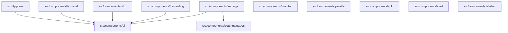

# 前端组件文档

本页描述 `src/` 下扫描到的 Vue 单文件组件体系。共 **53 个组件**，全部为 Vue 框架（`framework: vue`），**全部未检出测试配对**。

## 组件体系概述

- **框架**：全部组件为 Vue 组件，以 `.vue` 单文件形式存在（如 `src/App.vue`、`src/components/ui/Button.vue`）。
- **组织方式**：以功能域分目录——`components/ui`（基础控件）、`components/terminal`、`components/sftp`、`components/forwarding`、`components/monitor`、`components/palette`、`components/split`、`components/start`、`components/titlebar`，以及设置模块 `components/settings` 与其子目录 `components/settings/pages`；根级仅有一个应用组件 `src/App.vue`。
- **命名约定**：目录内文件使用大驼峰（PascalCase）与组件名一致；部分目录内存在以 `*Content`、`*Page`、`*Dialog`、`*Pane`、`*Card` 结尾的角色化命名（如 `TerminalTabContent`、`AboutPage`、`HostKeyDialog`、`SftpBrowserPane`、`HostCard`），推断用于区分「标签页内容层 / 设置页 / 对话框 / 窗格 / 卡片」等展示角色。

> 上图仅表示目录归属关系（由文件路径得出），不代表运行时依赖边。

## 被引用度口径说明

本页「被引用文件数」为**词法统计结果**：统计有多少个文件以词法方式引用了该组件，**不代表运行时调用次数、渲染次数或真实依赖强度**。同一组件在多个文件中被模板引用会被多次计数。此外，该口径不区分「生产代码引用」与「被其他组件间接引用」。

**props / emits 口径**：本页只获得数量，未获得具体的 prop 名、类型与事件名，因此清单中仅给出数量；数量为 0 表示**未检出** props 或 emits，不等于该组件绝对不接收属性或派发事件。

## 组件清单

| 组件 | 框架 | props | emits | 被引用文件数 | 测试配对 | 文件 |
| --- | --- | --- | --- | --- | --- | --- |
| App | vue | 0 | 0 | 17 | 无 | `src/App.vue` |
| ForwardRuleFormDialog | vue | 7 | 2 | 3 | 无 | `src/components/forwarding/ForwardRuleFormDialog.vue` |
| ForwardingTabContent | vue | 1 | 0 | 4 | 无 | `src/components/forwarding/ForwardingTabContent.vue` |
| MetricChart | vue | 8 | 0 | 1 | 无 | `src/components/monitor/MetricChart.vue` |
| MonitorSidebar | vue | 1 | 0 | 2 | 无 | `src/components/monitor/MonitorSidebar.vue` |
| CommandPalette | vue | 0 | 0 | 2 | 无 | `src/components/palette/CommandPalette.vue` |
| QuickCommandPalette | vue | 0 | 0 | 4 | 无 | `src/components/palette/QuickCommandPalette.vue` |
| WorkflowPalette | vue | 0 | 0 | 3 | 无 | `src/components/palette/WorkflowPalette.vue` |
| ColorSchemePicker | vue | 2 | 1 | 1 | 无 | `src/components/settings/ColorSchemePicker.vue` |
| GroupAccordion | vue | 6 | 3 | 3 | 无 | `src/components/settings/GroupAccordion.vue` |
| ProfileForwardingsCard | vue | 1 | 0 | 2 | 无 | `src/components/settings/ProfileForwardingsCard.vue` |
| SettingsView | vue | 1 | 0 | 7 | 无 | `src/components/settings/SettingsView.vue` |
| TabGroupFormDialog | vue | 3 | 2 | 1 | 无 | `src/components/settings/TabGroupFormDialog.vue` |
| AboutPage | vue | 0 | 0 | 1 | 无 | `src/components/settings/pages/AboutPage.vue` |
| AppearancePage | vue | 0 | 0 | 1 | 无 | `src/components/settings/pages/AppearancePage.vue` |
| BackupPage | vue | 0 | 0 | 2 | 无 | `src/components/settings/pages/BackupPage.vue` |
| BackupSyncSection | vue | 0 | 2 | 1 | 无 | `src/components/settings/pages/BackupSyncSection.vue` |
| ColorSchemesPage | vue | 0 | 0 | 1 | 无 | `src/components/settings/pages/ColorSchemesPage.vue` |
| HotkeysPage | vue | 0 | 0 | 1 | 无 | `src/components/settings/pages/HotkeysPage.vue` |
| KeysPage | vue | 0 | 0 | 1 | 无 | `src/components/settings/pages/KeysPage.vue` |
| LocalProfilesPage | vue | 0 | 0 | 1 | 无 | `src/components/settings/pages/LocalProfilesPage.vue` |
| QuickCommandsPage | vue | 0 | 0 | 1 | 无 | `src/components/settings/pages/QuickCommandsPage.vue` |
| SshPage | vue | 0 | 0 | 1 | 无 | `src/components/settings/pages/SshPage.vue` |
| TabGroupsPage | vue | 0 | 0 | 1 | 无 | `src/components/settings/pages/TabGroupsPage.vue` |
| TerminalPage | vue | 0 | 0 | 1 | 无 | `src/components/settings/pages/TerminalPage.vue` |
| WorkflowsPage | vue | 0 | 0 | 1 | 无 | `src/components/settings/pages/WorkflowsPage.vue` |
| SftpBrowserPane | vue | 7 | 3 | 3 | 无 | `src/components/sftp/SftpBrowserPane.vue` |
| SftpTabContent | vue | 2 | 0 | 2 | 无 | `src/components/sftp/SftpTabContent.vue` |
| TransferPopover | vue | 0 | 0 | 3 | 无 | `src/components/sftp/TransferPopover.vue` |
| SplitContainer | vue | 4 | 6 | 2 | 无 | `src/components/split/SplitContainer.vue` |
| SplitSpanner | vue | 1 | 1 | 1 | 无 | `src/components/split/SplitSpanner.vue` |
| HostCard | vue | 3 | 0 | 3 | 无 | `src/components/start/HostCard.vue` |
| StartPageContent | vue | 2 | 0 | 4 | 无 | `src/components/start/StartPageContent.vue` |
| CredentialDialog | vue | 1 | 2 | 3 | 无 | `src/components/terminal/CredentialDialog.vue` |
| ForwardPanel | vue | 2 | 1 | 2 | 无 | `src/components/terminal/ForwardPanel.vue` |
| HostKeyDialog | vue | 1 | 2 | 3 | 无 | `src/components/terminal/HostKeyDialog.vue` |
| SuggestionMenu | vue | 6 | 1 | 2 | 无 | `src/components/terminal/SuggestionMenu.vue` |
| TerminalPane | vue | 3 | 4 | 18 | 无 | `src/components/terminal/TerminalPane.vue` |
| TerminalTabContent | vue | 3 | 0 | 4 | 无 | `src/components/terminal/TerminalTabContent.vue` |
| TabStrip | vue | 1 | 0 | 6 | 无 | `src/components/titlebar/TabStrip.vue` |
| TabSwitcher | vue | 0 | 0 | 1 | 无 | `src/components/titlebar/TabSwitcher.vue` |
| TitleBar | vue | 0 | 0 | 5 | 无 | `src/components/titlebar/TitleBar.vue` |
| Button | vue | 2 | 0 | 25 | 无 | `src/components/ui/Button.vue` |
| ContextMenu | vue | 1 | 2 | 6 | 无 | `src/components/ui/ContextMenu.vue` |
| Dialog | vue | 2 | 1 | 14 | 无 | `src/components/ui/Dialog.vue` |
| DropdownMenu | vue | 1 | 2 | 1 | 无 | `src/components/ui/DropdownMenu.vue` |
| Input | vue | 1 | 0 | 15 | 无 | `src/components/ui/Input.vue` |
| Label | vue | 1 | 0 | 16 | 无 | `src/components/ui/Label.vue` |
| SearchableSelect | vue | 3 | 1 | 3 | 无 | `src/components/ui/SearchableSelect.vue` |
| Select | vue | 4 | 0 | 10 | 无 | `src/components/ui/Select.vue` |
| Separator | vue | 1 | 0 | 1 | 无 | `src/components/ui/Separator.vue` |
| Slider | vue | 4 | 0 | 2 | 无 | `src/components/ui/Slider.vue` |
| Switch | vue | 1 | 0 | 12 | 无 | `src/components/ui/Switch.vue` |

## 重点组件

以下按被引用文件数从高到低选取 8 个组件。**以下职责描述为推断**：依据是组件命名与所在目录，数据中不含组件职责字段或源码注释证据。所列事实（props 数、emits 数、被引用文件数、路径）均来自扫描数据。

### Button（被引用文件数 25，最高）

| 事实 | 值 | 锚点 |
| --- | --- | --- |
| props 数量 | 2 | `src/components/ui/Button.vue` |
| emits 数量 | 0（未检出） | `src/components/ui/Button.vue` |
| 被引用文件数 | 25 | `src/components/ui/Button.vue` |

位于通用控件目录 `src/components/ui/`，命名与 props 数（2）表明其为带少量配置项的基础按钮，是全部组件中被引用面最广的一个。

### TerminalPane（被引用文件数 18）

| 事实 | 值 | 锚点 |
| --- | --- | --- |
| props 数量 | 3 | `src/components/terminal/TerminalPane.vue` |
| emits 数量 | 4 | `src/components/terminal/TerminalPane.vue` |
| 被引用文件数 | 18 | `src/components/terminal/TerminalPane.vue` |

位于终端目录，emits 数为终端类组件中较高者（4）。在同目录内与 `TerminalTabContent`、`SuggestionMenu`、`HostKeyDialog`、`CredentialDialog`、`ForwardPanel` 并存。

### App（被引用文件数 17）

| 事实 | 值 | 锚点 |
| --- | --- | --- |
| props 数量 | 0（未检出） | `src/App.vue` |
| emits 数量 | 0（未检出） | `src/App.vue` |
| 被引用文件数 | 17 | `src/App.vue` |

唯一位于 `src/` 根级的组件（其余均在 `src/components/` 下），未检出 props/emits。

### Label（被引用文件数 16）

| 事实 | 值 | 锚点 |
| --- | --- | --- |
| props 数量 | 1 | `src/components/ui/Label.vue` |
| emits 数量 | 0（未检出） | `src/components/ui/Label.vue` |
| 被引用文件数 | 16 | `src/components/ui/Label.vue` |

`ui/` 目录下的单 props 组件，被引用面仅次于 Button。

### Input（被引用文件数 15）

| 事实 | 值 | 锚点 |
| --- | --- | --- |
| props 数量 | 1 | `src/components/ui/Input.vue` |
| emits 数量 | 0（未检出） | `src/components/ui/Input.vue` |
| 被引用文件数 | 15 | `src/components/ui/Input.vue` |

`ui/` 目录下的单 props 组件，未检出 emits（不代表其不派发输入相关事件，见口径说明）。

### Dialog（被引用文件数 14）

| 事实 | 值 | 锚点 |
| --- | --- | --- |
| props 数量 | 2 | `src/components/ui/Dialog.vue` |
| emits 数量 | 1 | `src/components/ui/Dialog.vue` |
| 被引用文件数 | 14 | `src/components/ui/Dialog.vue` |

`ui/` 目录下被引用最广的容器型组件。同域内另有 `DropdownMenu`（被引用 1）、`ContextMenu`（被引用 6）等弹出层组件，但 Dialog 的引用面明显更广。

### Switch（被引用文件数 12）

| 事实 | 值 | 锚点 |
| --- | --- | --- |
| props 数量 | 1 | `src/components/ui/Switch.vue` |
| emits 数量 | 0（未检出） | `src/components/ui/Switch.vue` |
| 被引用文件数 | 12 | `src/components/ui/Switch.vue` |

`ui/` 目录下的开关类控件，单 props。

### Select（被引用文件数 10）

| 事实 | 值 | 锚点 |
| --- | --- | --- |
| props 数量 | 4 | `src/components/ui/Select.vue` |
| emits 数量 | 0（未检出） | `src/components/ui/Select.vue` |
| 被引用文件数 | 10 | `src/components/ui/Select.vue` |

`ui/` 目录下 props 数最多（4）的选择类控件。同域另有 `SearchableSelect`（3 props / 1 emit，被引用 3），两者在命名上构成「基础选择 / 可搜索选择」的区分。

## 分组观察

| 目录 | 组件数 | 组件 | 锚点示例 |
| --- | --- | --- | --- |
| 根级 | 1 | App | `src/App.vue` |
| `ui/` | 12 | Button、ContextMenu、Dialog、DropdownMenu、Input、Label、SearchableSelect、Select、Separator、Slider、Switch | `src/components/ui/Button.vue` |
| `settings/pages/` | 12 | AboutPage、AppearancePage、BackupPage、BackupSyncSection、ColorSchemesPage、HotkeysPage、KeysPage、LocalProfilesPage、QuickCommandsPage、SshPage、TabGroupsPage、TerminalPage、WorkflowsPage 中的 13 项中除前 12 外见下 | `src/components/settings/pages/AboutPage.vue` |
| `settings/`（非 pages） | 5 | ColorSchemePicker、GroupAccordion、ProfileForwardingsCard、SettingsView、TabGroupFormDialog | `src/components/settings/SettingsView.vue` |
| `terminal/` | 7 | CredentialDialog、ForwardPanel、HostKeyDialog、SuggestionMenu、TerminalPane、TerminalTabContent | `src/components/terminal/TerminalPane.vue` |
| `palette/` | 3 | CommandPalette、QuickCommandPalette、WorkflowPalette | `src/components/palette/CommandPalette.vue` |
| `sftp/` | 3 | SftpBrowserPane、SftpTabContent、TransferPopover | `src/components/sftp/SftpBrowserPane.vue` |
| `forwarding/` | 2 | ForwardRuleFormDialog、ForwardingTabContent | `src/components/forwarding/ForwardRuleFormDialog.vue` |
| `monitor/` | 2 | MetricChart、MonitorSidebar | `src/components/monitor/MetricChart.vue` |
| `split/` | 2 | SplitContainer、SplitSpanner | `src/components/split/SplitContainer.vue` |
| `start/` | 2 | HostCard、StartPageContent | `src/components/start/HostCard.vue` |
| `titlebar/` | 3 | TabStrip、TabSwitcher、TitleBar | `src/components/titlebar/TitleBar.vue` |

两点值得注意的结构特征：

- **设置模块自成体系**：`settings/` 与 `settings/pages/` 合计承载了较多组件，`SettingsView` 被引用 7 次，是 `ui/` 之外被引用最多的业务组件（`src/components/settings/SettingsView.vue`）。`settings/pages/` 下大量组件的被引用文件数均为 1（如 `AboutPage`、`AppearancePage`、`ColorSchemesPage`、`HotkeysPage`、`KeysPage`、`LocalProfilesPage`、`QuickCommandsPage`、`SshPage`、`TabGroupsPage`、`TerminalPage`、`WorkflowsPage`），呈「一页一入口」的形态。
- **props 维度差异明显**：`MetricChart`（8 props）、`ForwardRuleFormDialog`（7）、`SftpBrowserPane`（7）、`GroupAccordion`（6）、`SuggestionMenu`（6）为 props 数最高的组件；而 `settings/pages/` 下多数页面组件 props 数与 emits 数均为 0（`src/components/settings/pages/AboutPage.vue`）。

## 测试配对情况

53 个组件的测试配对均为「无」。即扫描未检出与组件同名的配对测试文件。这不等于项目没有测试——本页数据未包含测试目录内容，无法判断这些组件是否被其他形式的测试覆盖。

## 待确认

1. **props / emits 的具体定义缺失**：数据只提供数量，未提供 prop 名、类型、默认值与事件名，因此无法给出任何组件的接口签名。缺证据：组件源码中的 `props` / `emits`（待确认） 声明。
2. **具体引用方缺失**：数据未提供引用每个组件的文件清单，故无法列出「谁引用了谁」。缺证据：引用关系明细（调用方列表）。
3. **测试覆盖情况未知**：测试配对全部为「无」，但无法据此判断是否存在非同名测试或端到端测试。缺证据：测试目录与测试文件清单。
4. **设计动机无证据**：本页未获得任何注释、提交信息或文档小节类证据，因此不对组件命名与分层的演进原因作叙述。缺证据：设计意图/演进类证据源。
## Related

- 同目录：[api.md](api.md) · [state.md](state.md) · [routing.md](routing.md)
- 共享 20 个符号：[overview.md](../01-overview/overview.md)
- 共享 19 个符号：[onboarding.md](../05-guides/onboarding.md)
- 共享 12 个符号：[modules.md](../02-architecture/modules.md)
- 总入口：[README](../README.md)

<!-- wiki:source: llm -->
