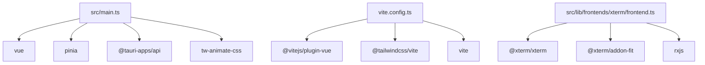

# 上手指南

<details>
<summary>Relevant source files</summary>

- src-tauri/build.rs
- src-tauri/capabilities/default.json
- src-tauri/Cargo.toml
- src-tauri/src/background.rs
- src-tauri/src/config/groups.rs
- src-tauri/src/config/legacy.rs
- src-tauri/src/config/load.rs
- src-tauri/src/config/mod.rs
- src/i18n/index.ts
- src/lib/frontendContext.ts
- src/lib/frontends/frontend.ts
- src/lib/frontends/xterm/frontend.ts
- src/lib/frontends/xterm/renderer.ts
- src/lib/frontends/xterm/resize.ts
- src/lib/frontends/xterm/search.ts
</details>

本页面向新加入的开发者，说明这个项目**是什么、需要准备什么环境、怎么装、有哪些可用命令、代码放在哪、如何开发调试**。全文只描述项目数据中可核实的内容，所有结论均给出文件路径锚点。

---

## 1. 项目速览

| 项目 | 内容 | 证据 |
| --- | --- | --- |
| 项目类型 | 前端（TypeScript） | 项目基础信息 |
| 桌面外壳 | Tauri（存在 Rust 侧工程与 Tauri 插件依赖） | `src-tauri/Cargo.toml`、`src-tauri/build.rs` |
| UI 框架 | Vue 3（`.vue` 单文件组件，全量导入点最多） | `src/App.vue`、`src/components/ui/Button.vue` |
| 状态管理 | Pinia | `src/stores/config/store.ts`、`src/stores/tabs.ts` |
| 构建工具 | Vite | `vite.config.ts` |
| 包管理器 | bun | 项目基础信息 |
| 语言 | TypeScript（构建时执行类型检查） | `bun run build` 中执行 `vue-tsc --noEmit` |
| 源码目录 | `src`（前端）、`src-tauri`（Rust 侧） | 见第 8 节 |
| 测试框架 | Vitest | `src/components/split/splitTree.test.ts` 等 |

一句话概括：这是一个 **Vue 3 + Vite 构建的 Tauri 桌面应用前端**，通过 `@tauri-apps/*` 系列插件调用系统能力，内含终端渲染、SFTP、端口转发、监控等界面模块（模块存在性见第 8 节目录清单）。

### 1.1 入口与汇总文件

| 入口文件 | 说明 | 证据 |
| --- | --- | --- |
| `src/main.ts` | 应用主入口，导入 Pinia、`@tauri-apps/api`、`tw-animate-css` | 依赖导入记录（`src/main.ts`） |
| `src/i18n/index.ts` | 国际化模块汇总入口（按目录与 `vue-i18n` 依赖推断） | 入口文件清单 + `src/App.vue` 导入 `vue-i18n` |
| `src/lib/motion/index.ts` | 动效模块汇总入口，导入 `gsap` | `src/lib/motion/index.ts` 导入 `gsap` |
| `src/lib/sessions/index.ts` | 会话模块汇总入口 | 入口文件清单（用途按目录命名推断） |
| `src/stores/config/index.ts` | 配置 store 汇总入口，与 `src/stores/config/store.ts` 同级 | `src/stores/config/store.ts` |

> 「推断」说明：上表中 `src/i18n/index.ts`、`src/lib/sessions/index.ts` 的具体职责是按**目录命名 + 同级文件导入关系**推断的，数据中未给出模块头注释或导出符号明细。

---

## 2. 技术栈与依赖使用证据

下表按"依赖 → 在项目中的实际使用位置"整理，便于判断某个包该在哪里找用法。

### 2.1 运行时框架与状态

| 依赖 | 用途（依据导入位置） | 代表性引用 |
| --- | --- | --- |
| `vue` | UI 框架，全项目导入点最多 | `src/App.vue`、`src/components/monitor/MetricChart.vue` |
| `pinia` | 全局状态管理 | `src/main.ts`、`src/stores/config/store.ts`、`src/stores/forwarding.ts`、`src/stores/monitor.ts`、`src/stores/tabs.ts` |
| `vue-i18n` | 多语言文案 | `src/App.vue`、`src/components/palette/CommandPalette.vue` |
| `rxjs` | 数据流/事件流处理 | `src/lib/frontends/frontend.ts`、`src/lib/frontends/xterm/frontend.ts`、`src/lib/middleware/middleware.ts`、`src/lib/middleware/oscProcessing.ts` |
| `deep-equal` | 深度比较（终端前端判断状态是否变化） | `src/lib/frontends/xterm/frontend.ts` |
| `nanoid` | 生成短 ID（配置项、条目标识） | `src/components/settings/pages/KeysPage.vue`、`src/components/settings/pages/SshPage.vue` |
| `yaml` | YAML 解析/序列化（配置与工作流） | `src/lib/workflowYaml.ts`、`src/stores/config/store.ts` |

### 2.2 Tauri 桌面能力

| 依赖 | 用途（依据导入位置） | 代表性引用 |
| --- | --- | --- |
| `@tauri-apps/api` | 调用 Rust 侧与系统 API 的主通道 | `src/main.ts`、`src/components/settings/pages/AboutPage.vue`、`src/components/sftp/SftpTabContent.vue` |
| `@tauri-apps/plugin-dialog` | 系统文件/目录选择对话框 | `src/components/settings/pages/BackupPage.vue`、`src/components/sftp/SftpBrowserPane.vue`、`src/services/workflowYamlIo.ts` |
| `@tauri-apps/plugin-notification` | 系统通知 | `src/services/notifications.ts` |
| `@tauri-apps/plugin-opener` | 用系统默认程序打开链接/文件 | `src/components/settings/pages/AboutPage.vue`、`src/lib/frontends/xterm/support.ts` |
| `@tauri-apps/plugin-updater` | 应用更新检查 | `src/services/updater.ts`、`src/components/settings/pages/AboutPage.vue` |
| `@tauri-apps/plugin-process` | 进程控制（配合更新流程） | `src/services/updater.ts` |
| `@tauri-apps/plugin-clipboard-manager` | 剪贴板读写 | `src/lib/frontendContext.ts` |
| `@tauri-apps/cli` | 提供 `tauri` 命令，用于 `app:dev` / `app:build` 脚本 | `bun run app:dev`、`bun run app:build` |

### 2.3 终端渲染（xterm 系列）

| 依赖 | 用途（依据导入位置） | 代表性引用 |
| --- | --- | --- |
| `@xterm/xterm` | 终端核心 | `src/lib/frontends/xterm/frontend.ts`、`options.ts`、`renderer.ts`、`resize.ts`、`lines.ts` |
| `@xterm/addon-fit` | 终端尺寸自适应 | `src/lib/frontends/xterm/frontend.ts`、`src/lib/frontends/xterm/resize.ts` |
| `@xterm/addon-canvas` / `@xterm/addon-webgl` | 渲染后端 | `src/lib/frontends/xterm/renderer.ts` |
| `@xterm/addon-search` | 终端内搜索 | `src/lib/frontends/xterm/search.ts` |
| `@xterm/addon-unicode11` / `@xterm/addon-web-links` | 宽字符处理与链接识别 | `src/lib/frontends/xterm/frontend.ts` |

### 2.4 UI 与样式

| 依赖 | 用途（依据导入位置） | 代表性引用 |
| --- | --- | --- |
| `reka-ui` | 无样式基础组件（Label/Separator/Slider/Switch 等） | `src/components/ui/Separator.vue`、`src/components/ui/Slider.vue` |
| `lucide-vue-next` | 图标库 | `src/components/monitor/MonitorSidebar.vue`、`src/components/forwarding/ForwardingTabContent.vue` |
| `class-variance-authority` | 组件变体样式定义 | `src/components/ui/Button.vue` |
| `clsx` + `tailwind-merge` | 类名拼接与冲突合并 | `src/lib/utils.ts` |
| `tailwindcss` | 样式基础设施 | `src/assets/styles/main.css` |
| `tw-animate-css` | 动画样式 | `src/main.ts` |
| `gsap` | 交互动画 | `src/lib/motion/index.ts` |

### 2.5 构建与工程工具

| 依赖 | 用途 | 代表性引用 |
| --- | --- | --- |
| `vite` | 开发服务器与打包 | `vite.config.ts` |
| `@vitejs/plugin-vue` | 让 Vite 处理 `.vue` 文件 | `vite.config.ts` |
| `@tailwindcss/vite` | Tailwind 的 Vite 集成 | `vite.config.ts` |
| `vue-tsc` | 类型检查，在 `build` 脚本中执行 | `bun run build` |
| `oxlint` | 代码检查 | `bun run lint`（`oxlint src`） |
| `vitest` | 单元测试运行器 | `src/components/titlebar/tabStripLayout.test.ts` 等 40 处导入 |
| `typescript` / `@types/node` / `@types/deep-equal` | 语言与类型声明依赖，不产生业务导入 | 工具链依赖 |

> 说明：`typescript`、`@types/*` 这类包以类型/编译支撑形式参与构建（由 `vue-tsc`、`tsconfig` 消费），不会出现在业务源码的 `import` 中，属正常现象。

### 2.6 依赖关系图（仅含已有导入证据）



---

## 3. 环境准备

| 依赖项 | 作用 | 为什么要装 | 证据 |
| --- | --- | --- | --- |
| Node.js | 运行 Vite、`vue-tsc`、Vitest 的 JS 运行时 | `bun run dev` / `build` / `test` 全部依赖 JS 运行时 | `vite.config.ts`、`bun run build` |
| bun | 项目的包管理器，负责安装依赖与执行脚本 | 数据中指定的包管理器 | 项目基础信息 |
| Rust 工具链（`cargo`） | 编译 `src-tauri` 下的 Rust 代码 | 仓库存在 Rust 工程与构建脚本；`app:dev` / `app:build` 会触发 Rust 编译 | `src-tauri/Cargo.toml`、`src-tauri/build.rs` |
| 平台 WebView 运行时 | Tauri 桌面窗口的渲染宿主 | Tauri 应用在开发/运行时需要系统 WebView | 属 Tauri 通用要求（`src-tauri/capabilities/default.json` 为 Tauri 能力配置） |

补充说明：

- 数据中未给出 `engines` 字段或具体 Node/Rust 版本约束，**待确认**：需要确认团队约定的 Node.js 与 Rust 版本（建议以 CI 或团队文档为准，不在此臆测）。
- `src-tauri/capabilities/default.json` 表明应用使用 Tauri 的能力（权限）声明机制，若新增 Tauri 插件调用，通常需要同步修改该文件——这是 Tauri 的标准机制。

---

## 4. 安装步骤

### 步骤 1：安装 bun

按 bun 官方方式安装完成后验证：

```bash
bun --version
```

预期输出：一行版本号（例如 `1.x.y`）。

### 步骤 2：安装依赖

```bash
bun install
```

预期输出：安装完成的包数量与耗时摘要，并在项目根目录生成/更新 lockfile 与 `node_modules`。

验证方式：

```bash
bun run lint
```

若命令正常启动 oxlint 并输出扫描结果（无 fatal error），说明依赖安装成功。

### 步骤 3：启动纯前端开发服务器

```bash
bun run dev
```

预期输出：Vite 打印本地访问地址（默认形如 `http://localhost:5173`）。浏览器打开该地址即可看到界面。

### 步骤 4：准备桌面端（首次较慢）

```bash
bun run app:dev
```

预期输出：先由 Vite 启动前端，随后 `cargo` 编译 `src-tauri` 下的 Rust 代码（首次编译耗时较长），最后弹出桌面窗口。

> 首次 `app:dev` 会下载并编译 Rust 依赖（见 `src-tauri/Cargo.toml`），请预留足够时间与磁盘空间。

---

## 5. 可用命令（来自项目 `scripts`）

项目未定义自定义 CLI 命令，全部通过包管理器执行 `scripts`：

| 命令 | 实际执行内容 | 作用 | 使用场景 |
| --- | --- | --- | --- |
| `bun run dev` | `vite` | 启动前端开发服务器，热更新 | 日常 UI 开发、组件调试 |
| `bun run build` | `vue-tsc --noEmit && vite build` | 先做类型检查，再打包产物 | 提交前自检、出包前置 |
| `bun run preview` | `vite preview` | 本地预览已构建产物 | 验证 `build` 结果是否符合预期 |
| `bun run app:dev` | `tauri dev` | 启动完整桌面应用（含 Rust 侧） | 调试需要系统能力（文件对话框、通知、剪贴板、更新等）的功能 |
| `bun run app:build` | `tauri build` | 构建可分发的桌面安装包 | 发版 |
| `bun run lint` | `oxlint src` | 对 `src` 目录做静态检查 | 提交前检查 |
| `bun run test` | `vitest run` | 单次运行全部单元测试 | 提交前、回归验证 |

---

## 6. 基本使用与典型工作流

### 6.1 纯前端日常循环

```bash
# 1. 起开发服务器
bun run dev

# 2. 改代码，浏览器热更新即时生效

# 3. 提交前跑类型检查 + 打包
bun run build

# 4. 预览构建产物
bun run preview
```

### 6.2 桌面功能开发循环

涉及 `@tauri-apps/*` 插件（文件对话框 `src/components/sftp/SftpBrowserPane.vue`、通知 `src/services/notifications.ts`、剪贴板 `src/lib/frontendContext.ts`、更新 `src/services/updater.ts`）时，必须在 Tauri 环境下验证：

```bash
bun run app:dev     # 开发调试
bun run app:build   # 产出安装包
```

### 6.3 测试与检查

```bash
bun run test    # vitest run：单次执行全部测试
bun run lint    # oxlint src
```

---

## 7. 环境变量

| 变量名 | 是否敏感 | 引用位置 |
| --- | --- | --- |
| `TAURI_ENV_HOST` | 否 | `vite.config.ts` |
| `TAURI_ENV_DEBUG` | 否 | `vite.config.ts` |

这两个变量在 `vite.config.ts` 中被读取，属构建期配置项，用于区分 Tauri 开发/调试运行环境。项目未提供生产环境引用位置。

---

## 8. 项目结构概览

仓库包含两个源码根目录：`src`（前端）与 `src-tauri`（Rust 侧）。

### 8.1 `src-tauri`（Rust 侧）

| 文件 | 作用 |
| --- | --- |
| `src-tauri/Cargo.toml` | Rust 工程依赖清单，`app:dev` / `app:build` 会据此编译 |
| `src-tauri/build.rs` | Tauri 构建脚本 |
| `src-tauri/capabilities/default.json` | Tauri 能力（权限）声明 |
| `src-tauri/src/background.rs` | 后台任务相关实现 |
| `src-tauri/src/config/mod.rs` | 配置模块入口 |
| `src-tauri/src/config/load.rs` | 配置加载 |
| `src-tauri/src/config/groups.rs` | 配置分组 |
| `src-tauri/src/config/legacy.rs` | 旧版配置兼容处理 |

从文件命名看，Rust 侧承担**配置持久化与迁移**（`config/load.rs`、`config/legacy.rs`）以及**后台任务**（`background.rs`）职责——该判断依据为文件路径与命名（推断）。

### 8.2 `src`（前端）

| 文件/目录 | 作用 | 数据中出现的文件样本 |
| --- | --- | --- |
| `src/main.ts` | 应用入口：挂载 Vue、注册 Pinia、引入全局动画样式 | `src/main.ts` |
| `src/App.vue` | 根组件 | `src/App.vue` |
| `src/assets/styles/` | 全局样式 | `src/assets/styles/main.css`（导入 `tailwindcss`）、`src/assets/styles/palette.css` |
| `src/components/forwarding/` | 端口转发界面 | `src/components/forwarding/ForwardRuleFormDialog.vue`、`ForwardingTabContent.vue`、`ForwardingTabContent.css` |
| `src/components/monitor/` | 监控/指标界面 | `src/components/monitor/MetricChart.vue`、`src/components/monitor/MonitorSidebar.vue` |
| `src/components/sftp/` | SFTP 浏览与传输界面 | `src/components/sftp/SftpBrowserPane.vue`、`src/components/sftp/SftpTabContent.vue`、`src/components/sftp/TransferPopover.vue` |
| `src/components/settings/pages/` | 设置页各分页 | `src/components/settings/pages/AboutPage.vue`、`AppearancePage.vue`、`BackupPage.vue`、`KeysPage.vue`、`LocalProfilesPage.vue`、`QuickCommandsPage.vue`、`SshPage.vue`、`TabGroupsPage.vue` |
| `src/components/settings/` | 设置页通用组件 | `src/components/settings/ColorSchemePicker.vue`、`GroupAccordion.vue` |
| `src/components/terminal/` | 终端相关组件 | `src/components/terminal/searchFocus.test.ts` |
| `src/components/split/` | 分屏布局 | `src/components/split/splitTree.test.ts` |
| `src/components/titlebar/` | 标题栏与标签页布局 | `src/components/titlebar/tabGroupLayout.test.ts`、`src/components/titlebar/tabStripLayout.test.ts` |
| `src/components/palette/` | 命令面板 | `src/components/palette/CommandPalette.vue` |
| `src/components/ui/` | 基础 UI 组件封装（基于 `reka-ui` 与 CVA 变体） | `src/components/ui/Button.vue`（导入 `class-variance-authority`）、`Label.vue`、`Separator.vue`、`Slider.vue`、`Switch.vue` |
| `src/lib/frontends/xterm/` | 终端前端的具体实现：渲染、尺寸、搜索、选项 | `frontend.ts`、`renderer.ts`、`resize.ts`、`search.ts`、`options.ts`、`lines.ts`、`support.ts` |
| `src/lib/frontends/` | 终端前端抽象层（多前端共用的接口与流） | `src/lib/frontends/frontend.ts` |
| `src/lib/middleware/` | 终端数据流中间件、OSC 转义序列处理 | `src/lib/middleware/middleware.ts`、`src/lib/middleware/oscProcessing.ts` |
| `src/lib/motion/` | 动效封装（GSAP 汇总入口） | `src/lib/motion/index.ts` |
| `src/lib/sessions/` | 会话模块汇总入口 | `src/lib/sessions/index.ts` |
| `src/lib/` | 通用工具与上下文 | `src/lib/utils.ts`（`clsx` + `tailwind-merge`）、`src/lib/frontendContext.ts`（剪贴板插件）、`src/lib/workflowYaml.ts`（YAML 解析） |
| `src/services/` | 与系统/后台交互的服务层 | `src/services/notifications.ts`（系统通知）、`src/services/updater.ts`（更新 + 进程控制）、`src/services/workflowYamlIo.ts`（文件对话框读写 YAML） |
| `src/stores/` | Pinia 状态仓库 | `src/stores/config/store.ts`、`src/stores/config/index.ts`、`src/stores/forwarding.ts`、`src/stores/monitor.ts`、`src/stores/tabs.ts` |
| `src/i18n/` | 国际化资源与初始化 | `src/i18n/index.ts` |

### 8.3 根目录构建配置

| 文件 | 作用 | 证据 |
| --- | --- | --- |
| `vite.config.ts` | Vite 配置：注册 Vue 插件、Tailwind 插件，并读取 `TAURI_ENV_HOST` / `TAURI_ENV_DEBUG` | `vite.config.ts`（导入 `vite`、`@vitejs/plugin-vue`、`@tailwindcss/vite`；读取两个环境变量） |

---

## 9. 开发指南

### 9.1 构建

```bash
bun run build     # vue-tsc --noEmit && vite build
```

该命令先做全量类型检查（`vue-tsc --noEmit`），再产出前端产物。**类型错误会直接中断构建**，因此本地改完代码后建议先跑这一条，而不是等打包阶段才发现问题。

需要在桌面端出包时：

```bash
bun run app:build   # tauri build
```

### 9.2 运行测试

```bash
bun run test        # vitest run
```

`vitest` 在项目中已被 40 处源代码文件引用，覆盖的测试样本包括：

| 测试文件 | 覆盖主题 |
| --- | --- |
| `src/components/split/splitTree.test.ts` | 分屏树结构 |
| `src/components/titlebar/tabStripLayout.test.ts` | 标签条布局 |
| `src/components/titlebar/tabGroupLayout.test.ts` | 标签分组布局 |
| `src/components/settings/groupDragSort.test.ts` | 设置分组拖拽排序 |
| `src/components/terminal/searchFocus.test.ts` | 终端搜索焦点 |

这些测试多为**布局/树结构等纯逻辑**用例，说明项目倾向于把可测逻辑从 `.vue` 组件中抽出到可单测的模块（例如 `src/components/split/`、`src/components/titlebar/` 下的布局计算）。

### 9.3 代码检查

```bash
bun run lint        # oxlint src
```

检查范围明确限定为 `src` 目录。

### 9.4 开发调试要点

| 场景 | 做法 | 依据 |
| --- | --- | --- |
| 只调 UI / 样式 | `bun run dev` 起 Vite 开发服务器即可，热更新最快 | `bun run dev` → `vite` |
| 调系统能力（文件对话框、通知、剪贴板、打开链接、更新） | 必须用 `bun run app:dev`，浏览器环境不具备这些能力 | `src/components/sftp/SftpBrowserPane.vue`、`src/services/notifications.ts`、`src/lib/frontendContext.ts`、`src/services/updater.ts` |
| 调终端渲染 | 关注 `src/lib/frontends/xterm/` 下的 `renderer.ts`（canvas/webgl 后端）、`resize.ts`（fit addon）、`search.ts`（search addon） | 各文件对 `@xterm/addon-*` 的导入 |
| 调终端数据处理 | 关注 `src/lib/middleware/`（`middleware.ts`、`oscProcessing.ts`），二者均基于 `rxjs` | `src/lib/middleware/middleware.ts`、`src/lib/middleware/oscProcessing.ts` |
| 调状态持久化 | 配置由 `src/stores/config/store.ts` 统一处理，其中导入 `yaml`；Rust 侧对应 `src-tauri/src/config/` 系列文件 | `src/stores/config/store.ts`、`src-tauri/src/config/load.rs` |
| 加法务/文案 | 国际化入口为 `src/i18n/index.ts`，组件通过 `vue-i18n` 消费 | `src/i18n/index.ts`、`src/App.vue` |

### 9.5 新增 Tauri 能力时的注意点

项目已使用的 Tauri 插件覆盖剪贴板、对话框、通知、打开器、进程、更新六类，能力声明集中在：

- 前端调用入口：`src/lib/frontendContext.ts`、`src/services/notifications.ts`、`src/services/updater.ts`、`src/components/settings/pages/BackupPage.vue`
- Rust 侧能力声明：`src-tauri/capabilities/default.json`

因此新增系统能力时，需要同时改**前端调用点**与 **`src-tauri/capabilities/default.json` 能力配置**，并回归验证 `bun run app:dev` 下的实际行为。

---

## 10. 上手检查清单

按顺序执行即可确认本地环境完整可用：

| 步骤 | 命令 | 通过标准 |
| --- | --- | --- |
| 1 | `bun install` | 依赖安装成功，无 fatal error |
| 2 | `bun run lint` | oxlint 正常输出扫描结果 |
| 3 | `bun run test` | 全部用例通过 |
| 4 | `bun run build` | 类型检查通过 + Vite 打包成功 |
| 5 | `bun run dev` | 浏览器可访问开发服务器地址 |
| 6 | `bun run app:dev` | 弹出桌面窗口（首次需等待 Rust 编译） |

---

## 11. 待确认

| 项 | 缺什么证据 |
| --- | --- |
| Node.js 与 Rust 工具链的具体版本要求 | 数据中无 `engines` 字段或工具链版本声明，无法给出确定版本号 |

其余信息（命令、依赖用途、目录职责、环境变量）均已在数据中找到对应锚点，故不再列出。
## Related

- 同目录：[testing.md](testing.md) · [troubleshooting.md](troubleshooting.md)
- 共享 7 个源文件、共享 65 个符号：[overview.md](../01-overview/overview.md)
- 共享 6 个源文件、共享 27 个符号：[modules.md](../02-architecture/modules.md)
- 共享 6 个源文件、共享 25 个符号：[tech-stack.md](../01-overview/tech-stack.md)
- 总入口：[README](../README.md)

<!-- wiki:source: llm -->
