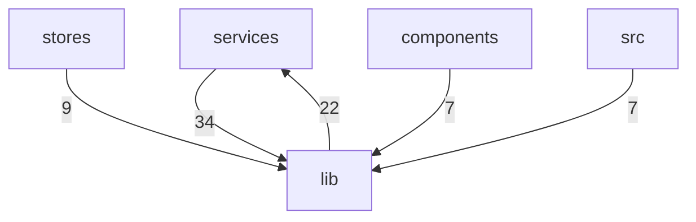

# CI 构建包 keypress 补发导致 ⌘T 双开（根因与调试手法）

Relevant source files

- src/lib/frontends/xterm/frontend.ts
- src/lib/frontends/xterm/keyboard.ts
- src/lib/hotkeys/hotkeys.ts

## 主题定位

本页描述的是仓库中一条横跨 `lib/frontends/xterm` 与 `lib/hotkeys` 两个目录的**键盘事件 ↔ 热键状态机协作面**：xterm 终端前端把键盘事件（`keydown`/`keyup`）馈入热键状态机，热键模块负责把用户可读的按键串（如 `"⌘-Shift-P"`、`"Ctrl-K"`）解析、归一化为可比较的形式 ，前端本体则负责终端实例装配与键盘/事件接线 。

它值得单独成页的原因在于：这条链路同时被上层多个模块引用——`services` 向 `lib` 发起 34 次调用、`lib` 反向调用 `services` 22 次，此外 `stores`（9 次）、`components`（7 次）、`src`（7 次）也各自调用 `lib` 。也就是说，键盘热键链的任何改动都处在仓库最密集的跨模块调用带之上。

需要先向读者交代一处证据缺口：本页标题所指向的具体故障叙事——「CI 构建包」「keypress 补发」「⌘T 双开」——在本次提供的证据集中**没有任何对应锚点**。本页可验证的内容只到"键盘事件处理链与热键状态机的衔接方式"这一层。相关根因与调试手法见文末「待确认」。

## 职责与范围

本主题覆盖 3 个生产文件（数据中未提供其它同主题文件），分工如下：

| 文件 | 职责 | 依据 |
| --- | --- | --- |
| `src/lib/frontends/xterm/keyboard.ts` | xterm 键盘事件处理链：备用屏方向键透传、`Ctrl-/`、`Ctrl-@` 显式编码、热键状态机喂入与 Linux IME 放行；内容原为 `XTermFrontend` 构造器内的闭包 | 文件头自述 ；首次提交 `commit:0f06722c (2026-09-25)`，提交信息为「refactor: 大文件拆分为模块目录并修复监控并发」 |
| `src/lib/frontends/xterm/frontend.ts` | xterm.js 前端本体（移植自 tabby-terminal 的 xtermFrontend）：终端实例装配、键盘/事件接线、挂载与销毁、配置与搜索 API；流控/键盘链/重排调度/渲染器/行读取等支撑件放在 `xterm/` 子模块 | 文件头自述 ；类注释  |
| `src/lib/hotkeys/hotkeys.ts` | 面向用户的按键串解析与归一化：`parseKeystroke` / `normalizeKeyName` / `normalizeHotkeysConfig` | 符号注释 ；首次提交 `commit:b5fb9da6 (2026-09-13)`，提交信息为「feat: 初始化」 |

从提交时间看，`hotkeys.ts` 早于 `keyboard.ts` 约一年出现（2026-09-13 → 2026-09-25）；`keyboard.ts` 的诞生动因是把原本塞在 `XTermFrontend` 构造器里的闭包抽出来，与文件头自述的「原 XTermFrontend 构造器内的闭包」互相印证 。

## 关键符号

数据中未提供符号的签名与实现体，以下符号来自意图注释条目记录的注释原文与锚点。

| 符号 | 锚点 | 角色 |
| --- | --- | --- |
| `HotkeyTarget` | `src/lib/frontends/xterm/keyboard.ts:9` | 热键状态机接口，结构兼容 `services/hotkeys` 的 `HotkeysManager`（待确认）  |
| `KeyboardHandlerDeps` | `src/lib/frontends/xterm/keyboard.ts:15` | `keyboardEventHandler` 的依赖集，由前端实例注入，用于保持纯函数可测  |
| `createKeyboardEventHandler` | `src/lib/frontends/xterm/keyboard.ts:28` | 工厂函数，返回 `(name: 'keydown'\|'keyup', event: KeyboardEvent) => boolean`  |
| `XTermFrontend` | `src/lib/frontends/xterm/frontend.ts:27` | xterm.js 终端前端，移植自 tabby-terminal 对应实现  |
| `XTermWebGLFrontend` | `src/lib/frontends/xterm/frontend.ts:501` | 启用 WebGL 渲染器的 XTerm 前端，并带 canvas 回退  |
| `parseKeystroke` | `src/lib/hotkeys/hotkeys.ts:109` | 把用户可读按键串（`"⌘-Shift-P"` / `"Ctrl-K"`）解析为部件  |
| `normalizeKeyName` | `src/lib/hotkeys/hotkeys.ts:129` | 按键名归一化，示例 `normalizeKeyName('KeyA') // 'A'`  |
| `normalizeHotkeysConfig` | `src/lib/hotkeys/hotkeys.ts:160` | 热键配置归一化，示例 `'⌘-⌥-ArrowRight'` → `'⌘-⌥-Right'`  |

**`keyboard.ts` 的三个符号。** `HotkeyTarget` 被显式定义为与 `services/hotkeys` 的 `HotkeysManager`（待确认） **结构兼容**的接口 ——这是该文件与 services 层之间的类型契约点，也是热键状态机得以被"喂入"的类型前提。`KeyboardHandlerDeps` 承载处理器所需的外部依赖，注释给出了明确的设计意图：**由前端实例注入，保持纯函数可测** 。`createKeyboardEventHandler` 是这条链的出口：它产出一个接收 `'keydown' | 'keyup'` 事件名与 `KeyboardEvent`、返回布尔值（是否已消费）的处理函数 ；返回布尔值意味着热键命中后需要决定事件是否继续下发，但数据中未给出具体分支逻辑。

**`frontend.ts` 的两个类。** `XTermFrontend` 是终端前端本体，承担实例装配、键盘/事件接线、挂载销毁与配置搜索 API 。`XTermWebGLFrontend` 是它的渲染增强变体，在 WebGL 渲染器不可用时退回 canvas 。键盘链路正是接在 `XTermFrontend` 的装配流程上。

**`hotkeys.ts` 的三个函数。** 三者构成一条"输入规范化"流水线：`parseKeystroke` 把用户书写的按键串拆成部件 ，`normalizeKeyName` 把浏览器键盘码统一成可比名字（`KeyA` → `A`），`normalizeHotkeysConfig` 在配置层做同样的归一（`⌘-⌥-ArrowRight` → `⌘-⌥-Right`）。三者共同保证"用户写的按键串"和"实际收到的键盘事件"能落到同一套表示上——这正是双击发类问题的观测面所在（两个来源各归一一次，如果归一结果不一致，就会出现匹配失败或重复匹配）。

## 协作方式

数据中共记录 3 条调用边，全部位于 `src/lib/frontends/xterm/frontend.ts` 内部，且全部由 `attach` 发起：

| 调用方 | 被调用方 | 位置 | 证据 |
| --- | --- | --- | --- |
| `attach` | `isAttachActive` | `src/lib/frontends/xterm/frontend.ts:53` |  |
| `attach` | `resizeHandler` | `src/lib/frontends/xterm/frontend.ts:160` |  |
| `attach` | `configureColors` | `src/lib/frontends/xterm/frontend.ts:409` |  |

按行号顺序读，装配阶段（`attach`）的调用序列是：先在第 53 行做活性判定（`isAttachActive`，可判断为挂载前的守卫），随后在第 160 行挂尺寸变更处理，最后在第 409 行配置配色 。也就是说，**附件（attach）是一个带前置判定、随后逐个接线子系统的装配例程**。

需要如实指出：`keyboard.ts` 与 `frontend.ts` 之间的跨文件配合，在这份边表里**没有对应的调用边**。数据中唯一可用的证据是 `KeyboardHandlerDeps` 的注释——依赖"由前端实例注入" ，即前端实例在装配时构造依赖集并交给 `createKeyboardEventHandler` 。注入点位于 `frontend.ts` 的哪一行、`attach` 是否就是注入者，数据未提供锚点，不做推测。

`hotkeys.ts` 与前端之间的协作方式同样不在边表中；可确认的只有它对外暴露的三个解析/归一函数 。

## 跨模块边界

本主题所在目录属于 `lib` 层，其对外耦合面按调用方向统计如下：

| 方向 | 调用次数 | 证据 |
| --- | --- | --- |
| `services` → `lib` | 34 |  |
| `lib` → `services` | 22 |  |
| `stores` → `lib` | 9 |  |
| `components` → `lib` | 7 |  |
| `src` → `lib` | 7 |  |

**耦合点判读。** `lib` 与 `services` 之间是**双向**调用（34 / 22），这是所有边界中唯一成环的一条；其余三个方向（`stores`、`components`、`src`）都是单向调用 `lib` 。热键状态机的类型契约 `HotkeyTarget` 恰恰被注明"结构兼容 `services/hotkeys` 的 `HotkeysManager`（待确认）" ，与双向调用关系互相印证：热键链是 lib 与 services 之间耦合的落点之一。

**修改代价（推断）。** 基于上述调用次数分布，改动键盘/热键链的对外接口会同时波及 `services`、`stores`、`components`、`src` 四个方向的调用点，其中 `services` 侧影响最大（34 次入向调用）。这一代价判断属于推断，依据是边界调用计数本身，数据中未提供具体的调用点清单。

## 设计动机

**可测性优先的依赖注入。** `KeyboardHandlerDeps` 的注释原文是「`keyboardEventHandler` 的依赖集（由前端实例注入，保持纯函数可测）」。这条注释直接说明了把依赖从构造器闭包中抽出的原因：让键盘处理逻辑脱离前端实例可独立测试。

**结构性类型解耦。** `HotkeyTarget` 的注释原文是「热键状态机接口（结构兼容 `services/hotkeys` 的 `HotkeysManager`（待确认））」。用结构化接口而非直接依赖 `services/hotkeys` 的具体类，使得 `keyboard.ts` 不必硬绑定 services 层实现。

**大文件拆分的产物。** `keyboard.ts` 的首次提交信息为「refactor: 大文件拆分为模块目录并修复监控并发」（`commit:0f06722c`，2026-09-25），文件头亦自述其内容原本是「原 `XTermFrontend` 构造器内的闭包」。二者共同构成该文件独立成模块的动机证据。

**外部血统。** `frontend.ts` 的文件头说明支撑件（流控/键盘链/重排调度/渲染器/行读取）被安置在 `xterm/` 子模块 ，类注释则记录其移植自 tabby-terminal 的对应实现 ——这解释了为什么该目录下会出现键盘链、渲染器、行读取等多个平行子模块。

**局部约束的记录习惯。** `frontend.ts:120` 保留了一条 `NOTE:` 形式的说明："xterm.onScroll only fires for content-driven scroll (new lines)" 。这体现了该文件用行内注释记录第三方库行为边界的习惯；需注意该注释针对的是滚动行为，与键盘链路无直接关系，此处仅作为文件注释风格的佐证。

## 待确认

1. **标题所述根因与调试手法缺乏证据。** 本页标题中的「CI 构建包差异」「keypress 补发」「⌘T 双开」在提供的证据集中均无对应文件、符号或边；`⌘T` 的绑定位置、`keypress` 事件的处理点都未被数据覆盖。要补齐这部分，需要 CI 构建产物与本地开发的差异证据、`keypress` 事件监听的锚点，以及 `⌘T` 所绑定命令的调用链。
2. **键盘事件的运行机制无法完整描述。** 数据只给出 `createKeyboardEventHandler` 返回 `(name: 'keydown'|'keyup', event: KeyboardEvent) => boolean` ，未提供其内部的分支、状态迁移与事件消费/放行判断，因此"热键命中后事件是否继续下发""备用屏方向键透传的具体条件"等机制无法以确定语气叙述。
3. **符号清单为空的缺环。** 本页关键符号的锚点来自注释条目，缺少完整的签名定义与实现体；`HotkeyTarget` 与 `KeyboardHandlerDeps` 的字段构成、`XTermFrontend` 的公开方法集合均不可知。
4. **`keyboard.ts` 与 `frontend.ts` 的注入点未锚定。** 可确认依赖"由前端实例注入" ，但注入调用发生在 `frontend.ts` 的哪一行、由哪个方法发起，数据未给出调用边。
## Related

- 同目录：[frontends-middleware-services.md](frontends-middleware-services.md)
- 共享 1 个源文件、共享 7 个符号：[glossary.md](../07-reference/glossary.md)
- 共享 7 个符号：[modules.md](../02-architecture/modules.md)
- 共享 5 个符号：[architecture.md](../02-architecture/architecture.md)
- 总入口：[README](../README.md)

<!-- wiki:source: llm -->
