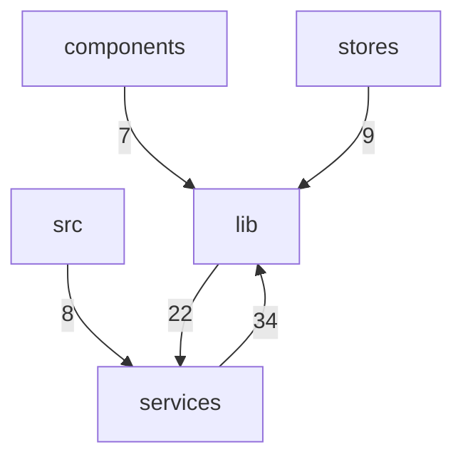

# frontends · middleware · services 跨模块协作

<details>
<summary>Relevant source files</summary>

- src/lib/frontends/xterm/renderer.ts
- src/lib/frontends/xterm/resize.ts
- src/lib/frontends/xterm/support.ts
- src/lib/middleware/inputProcessing.ts
- src/lib/middleware/middleware.ts
- src/lib/middleware/oscProcessing.ts
- src/lib/sessions/localSession.ts
- src/lib/sessions/sshSession.ts
- src/lib/suggestions/promptTracker.ts
- src/services/hotkeys.ts
- src/services/pathCompletion.ts
- src/services/sshConnections.ts
</details>

本页描述的是本仓库中横跨**服务层（services）**、**中间件层（lib/middleware）**、**终端前端层（lib/frontends/xterm）**、**会话层（lib/sessions）**与**建议/输入行层（lib/suggestions）**的一条协作面：它把「终端输入与输出的字节流处理」「OSC 序列解析」「快捷键拦截」「SSH 连接注册与状态镜像」「初始渲染器挂载」这些分散在 5 个目录下的职责串在一起。之所以值得单独成页，是因为这批文件之间的依赖在模块边界统计中是全仓最重的一对方向（`services→lib` 34 次、`lib→services` 22 次），且**双向**——任何一侧的公共导出变更都会同时波及另一侧，这是固定文档页面（按目录/模块划分）无法呈现的耦合面。

---

## 一、主题覆盖的文件与分工

### 1.1 文件清单（按层归组）

| 层 | 文件 | 在主题中的分工 | 证据 |
|---|---|---|---|
| services | `src/services/sshConnections.ts` | SSH 连接注册表服务的 IO 接线：headless 建连走 SshProxy、hostkey 确认经全局 `pendingHostKey` 供 App 层对话框呈现、断连走 `ssh_kill`；同时维护档案级连接状态的 reactive 镜像，`registryVersion` 在连接集合变化时自增供组件 watch |  |
| services | `src/services/hotkeys.ts` | 快捷键服务，锚定 xterm 的 `attachCustomKeyEventHandler`——处理本会被终端消费掉的按键 |  |
| services | `src/services/pathCompletion.ts` | 本页数据未提供该文件的符号或注释证据 | — |
| lib/middleware | `src/lib/middleware/oscProcessing.ts` | OSC 序列处理：OSC 52 剪贴板写入限流、OSC 7 工作目录解析、`OSCProcessor` 主体 |  |
| lib/middleware | `src/lib/middleware/inputProcessing.ts` | 本页数据未提供该文件的符号或注释证据 | — |
| lib/middleware | `src/lib/middleware/middleware.ts` | 本页数据未提供该文件的符号或注释证据 | — |
| lib/frontends/xterm | `src/lib/frontends/xterm/renderer.ts` | 前端渲染器挂载与降级：`attach` 按前端配置挂载初始渲染器并记录字体指纹 |  |
| lib/frontends/xterm | `src/lib/frontends/xterm/support.ts` | 本页数据未提供该文件的符号或注释证据 | — |
| lib/frontends/xterm | `src/lib/frontends/xterm/resize.ts` | 本页数据未提供该文件的符号或注释证据 | — |
| lib/sessions | `src/lib/sessions/sshSession.ts` | 本页数据未提供该文件的符号或注释证据 | — |
| lib/sessions | `src/lib/sessions/localSession.ts` | 本页数据未提供该文件的符号或注释证据 | — |
| lib/suggestions | `src/lib/suggestions/promptTracker.ts` | 输入行模型：从 xterm buffer 现读现算逻辑行、提示符剥离、续行合并、词定位，并在其上做提示符长度自适应学习与回车命令采集 |  |

### 1.2 分工模式小结

- **services 侧**承担「跨进程/跨资源的接线」：SSH 建连与断连、按键拦截；其中 `sshConnections.ts` 还额外承担了一份**面向 UI 的响应式镜像**（连接状态、连接来源、错误文本），说明服务层在该协作面中不只是命令通道，也是状态源 。
- **lib/middleware 侧**承担「终端字节流层面的解释与限流」：OSC 序列解析与剪贴板写入上限 。
- **lib/frontends/xterm 侧**承担「渲染后端选择」：WebGL 优先、Canvas 兜底 ，并有明确的挂载调用链（见第三节）。
- **lib/suggestions 侧**承担「从终端缓冲区反推逻辑输入行」，其自述明确说明该模型**不维护影子副本**，对 shell 端编辑免疫 。
- **lib/sessions 侧**（`sshSession.ts` / `localSession.ts`）在本页数据中只有文件路径，没有符号或注释证据，其在协作面中的具体职责**待确认**。

---

## 二、关键符号

### 2.1 `attach`（核心符号）

```ts
attach(enableWebGL: boolean)   // src/lib/frontends/xterm/renderer.ts:37
```

`attach` 的注释为「按前端配置挂载初始渲染器（WebGL 优先，Canvas 兜底）并记录字体指纹」，复杂度为 1 。它是本主题中唯一被单列的符号，也是终端前端层的入口：调用方传入一个布尔量（是否启用 WebGL）后，由它决定挂载哪种渲染后端，并把「字体指纹」这一环境标识记录下来 。

从调用边看，`attach` 并不自己完成 WebGL 的装配，而是在 `src/lib/frontends/xterm/renderer.ts:116` 处转交给 `attachWebGL` ；`attachWebGL` 又在 `src/lib/frontends/xterm/renderer.ts:104` 处调用 `recover` 。这条 `attach → attachWebGL → recover` 链是本页唯一有锚点支撑的**多级挂载/降级路径**。（`recover` 的具体语义与触发条件在本页数据中没有注释或签名证据，**待确认**。）

### 2.2 其他带注释证据的核心符号

| 符号 | 位置 | 角色（引自注释原文语义） | 证据 |
|---|---|---|---|
| `HotkeysService` | `src/services/hotkeys.ts:14` | 「xterm's `attachCustomKeyEventHandler`（keys that would otherwise be consumed by the terminal）」——即接管会被终端吞掉的组合键 |  |
| `connectionStates` | `src/services/sshConnections.ts:20` | 「档案级连接状态镜像（key = profileId）」 |  |
| `connectionSources` | `src/services/sshConnections.ts:22` | 「连接来源（pane = 复用终端窗格连接；background = 后台 headless 连接）」 |  |
| `connectionErrors` | `src/services/sshConnections.ts:24` | 「最近一次连接错误文本（失败 banner 展示）」 |  |
| `OSC52_MAX_CLIPBOARD_BYTES` | `src/lib/middleware/oscProcessing.ts:9` | 「OSC 52 剪贴板写入内容的字节上限（对齐 Tabby，防止远端程序灌爆剪贴板）」 |  |
| `parseOsc7Cwd` | `src/lib/middleware/oscProcessing.ts:36` | 解析 OSC 7 上报的工作目录，示例：`parseOsc7Cwd('file:///tmp/my%20dir') // '/tmp/my dir'` |  |
| `OSCProcessor` | `src/lib/middleware/oscProcessing.ts:61` | OSC 序列处理主体，「Ported from [REDACTED].ts (OSC 7 added).」 |  |
| `readLogicalLine` | `src/lib/suggestions/promptTracker.ts:33` | 现读现算当前逻辑行，示例：`readLogicalLine(access) // { text: 'user@mac ~ % git che', cursorOffset: 18 }` |  |
| `stripPrompt` | `src/lib/suggestions/promptTracker.ts:66` | 按提示符长度剥离，示例：`stripPrompt({ text: 'user@mac ~ % git', cursorOffset: 17 }, 13) // { text: 'git', cursorOffset: 4 }` |  |
| `mergeContinuationLines` | `src/lib/suggestions/promptTracker.ts:82` | 续行合并，示例：`mergeContinuationLines(['git push \\', '> --force']) // 'git push --force'` |  |
| `DEFAULT_MAX_PROMPT_JUMP` | `src/lib/suggestions/promptTracker.ts:125` | 「promptLen 学习跳变上限：超出视为异步输出污染，丢弃本次学习」 |  |

这些符号共同说明：该协作面的一端是**来自远端的字节流与终端缓冲区**（OSC 序列、逻辑行、提示符），另一端是**面向 UI 的可展示状态**（连接徽标、错误 banner、渲染后端）。

---

## 三、协作方式（调用边）

本页数据提供的调用边**全部落在单个文件内部**，跨层协作关系由第四节的模块边界调用计数体现。

| 调用方 | 被调用方 | 位置 | 文件归属 | 证据 |
|---|---|---|---|---|
| `acquireConnection` | `refreshMirror` | `src/services/sshConnections.ts:170` | 同文件（服务层内部） |  |
| `attach` | `attachWebGL` | `src/lib/frontends/xterm/renderer.ts:116` | 同文件（前端层内部） |  |
| `attachWebGL` | `recover` | `src/lib/frontends/xterm/renderer.ts:104` | 同文件（前端层内部） |  |

**可确认的两条链路语义：**

1. **连接建立 → 镜像刷新**：`acquireConnection` 在 `src/services/sshConnections.ts:170` 调用 `refreshMirror` 。结合文件头自述中「维护档案级连接状态的 reactive 镜像」 与 `connectionStates` 的「档案级连接状态镜像（key = profileId）」注释 ，可以确认这是一条「连接获取成功后同步 UI 可见状态」的路径。
2. **渲染器挂载 → WebGL 装配 → 恢复**：`attach` 在 `renderer.ts:116` 转入 `attachWebGL` ，后者在 `renderer.ts:104` 调用 `recover` 。与 `attach` 的「WebGL 优先，Canvas 兜底」注释  结合，这条链构成前端层的后端选择与降级骨架。

**推断**：`recover` 的命名与它在 `attachWebGL` 之后被调用的位置，提示其可能与 WebGL 上下文异常后的恢复有关；但数据中没有该方法签名、注释或异常处理点，此仅为基于命名与调用位置的推断 。

---

## 四、跨模块边界与修改代价

### 4.1 模块依赖图（仅含边界数据中出现的方向与计数）



### 4.2 边界调用表

| 方向 | 调用次数 | 性质与修改代价 | 证据 |
|---|---|---|---|
| services → lib | 34 | 本协作面中**最重的单向依赖**。服务层的改动会大量落入 lib 的工具/会话/中间件实现，lib 侧公共导出签名变更是本主题内影响面最大的改动 |  |
| lib → services | 22 | 与上一条构成**反向回环**：lib 又反过来调用服务层，形成双向依赖。该方向使两层无法独立拆分，任一侧的重命名/移动都会同时触发另一侧改动 |  |
| stores → lib | 9 | 状态层依赖 lib，说明 lib 侧的输出同时被状态层消费 |  |
| src → services | 8 | 应用入口层直接触达服务层，是本协作面中少数「跳过 lib」的直连路径 |  |
| components → lib | 7 | 组件层依赖 lib，是 `lib/frontends/xterm`、`lib/suggestions` 等能力的 UI 侧消费口 |  |

### 4.3 耦合点判读

- **核心耦合点是 services ↔ lib 的双向边**（34 + 22 = 56 次调用）。这两条边是同一对模块之间的往返关系，因此本主题的「协作面」实质是**一条双向缝**：`src/services/sshConnections.ts` 与 `src/services/hotkeys.ts` 提供 IO 与按键接线，`src/lib/middleware/*`、`src/lib/frontends/xterm/*`、`src/lib/sessions/*`、`src/lib/suggestions/*` 提供终端语义与渲染能力 。
- **次级耦合点是 components/stores → lib**（7 + 9 次）。这说明 lib 层的能力被上层 UI 与状态层共同消费，lib 的导出是跨这一批文件的稳定契约面。
- **`src → services` 是唯一的入口直连边**（8 次），配合 `sshConnections.ts` 自述中「hostkey 确认经全局 `pendingHostKey` 供 App 层对话框呈现」，可确认存在一条「服务层准备数据 → App 层呈现对话框」的交互分工。

---

## 五、设计动机（证据原文引用）

以下动机均引自数据中提供的文件头自述与符号注释原文，锚点保留原样。

### 5.1 连接状态为什么要做成 reactive 镜像

> 「@description SSH 连接注册表服务：SshConnectionRegistry 的 IO 接线——headless 建连走 SshProxy（hostkey 确认经全局 pendingHostKey 供 App 层对话框呈现）、断连走 ssh_kill；并维护档案级连接状态的 reactive 镜像（供 SFTP 标签/隧道管理器展示 「复用终端连接 / 后台连接」徽标与断线重连）。registryVersion 在任何连接 集合变化时自增，供组件 watch」
> —— `src/services/sshConnections.ts:1` 

该自述给出了三项明确的动机锚点：(1) 建连/断连的 IO 落点（SshProxy / `ssh_kill`）；(2) hostkey 确认通过全局 `pendingHostKey` 交由 App 层对话框呈现，即**服务层不做 UI**；(3) 镜像与 `registryVersion` 的存在理由是**供外部组件 watch 与展示徽标、支持断线重连** 。对应的三个镜像字段各自有注释说明其消费场景：状态镜像供档案级查询 、来源区分「复用终端窗格连接」与「后台 headless 连接」、错误文本供失败 banner 展示 。

### 5.2 输入行模型为什么不缓存

> 「@description 输入行模型：从 xterm buffer 现读现算当前逻辑行（soft-wrap 链拼接）、提示符剥离、续行合并、词定位；PromptTracker 在此之上做提示符长度自适应学习与回车命令采集。对 shell 端编辑（Tab 补全/↑ 调历史/Ctrl+R）免疫——永不维护影子副本。」
> —— `src/lib/suggestions/promptTracker.ts:1` 

这条自述直接解释了 `readLogicalLine` 的「现读现算」设计：因为 shell 端自身会改写输入行（Tab 补全、历史调取、Ctrl+R 搜索），任何影子副本都会与之失配，所以模型选择每次从 buffer 重新计算 。

### 5.3 提示符长度学习的防护阈值

> 「promptLen 学习跳变上限：超出视为异步输出污染，丢弃本次学习」
> —— `src/lib/suggestions/promptTracker.ts:125` 

该常量的动机是**区分真实的提示符变化与异步输出造成的噪声**：学习值跳变超过上限即判定为污染并丢弃本次样本 。

### 5.4 OSC 剪贴板写入为什么要限流

> 「OSC 52 剪贴板写入内容的字节上限（对齐 Tabby，防止远端程序灌爆剪贴板）」
> —— `src/lib/middleware/oscProcessing.ts:9` 

动机是防御性的：远端程序可通过 OSC 52 写入本机剪贴板，因此设置字节上限，并显式说明对齐 Tabby 的既有行为 。

### 5.5 OSCProcessor 的来源与扩展

> 「Ported from [REDACTED].ts (OSC 7 added).」
> —— `src/lib/middleware/oscProcessing.ts:61` 

该注释记录了 `OSCProcessor` 的移植来源，并标注 OSC 7 支持是移植时新增的能力 ；OSC 7 解析的具体行为由 `parseOsc7Cwd` 的示例锚定（`'file:///tmp/my%20dir'` → `'/tmp/my dir'`，即 URI 解码）。

### 5.6 快捷键服务为什么要挂在 xterm 回调上

> 「xterm's attachCustomKeyEventHandler (keys that would otherwise be consumed by the terminal).」
> —— `src/services/hotkeys.ts:14` 

动机是拦截**会被终端优先消费**的按键，因此 `HotkeysService` 选择接入 xterm 自身的按键处理回调，而不是在更外层监听键盘事件 。

### 5.7 渲染器挂载策略

> 「按前端配置挂载初始渲染器（WebGL 优先，Canvas 兜底）并记录字体指纹」
> —— `src/lib/frontends/xterm/renderer.ts:37` 

`attach(enableWebGL: boolean)` 以一个布尔入参表达「是否启用 WebGL」，兜底路径的存在说明渲染后端选择是运行期决策而非编译期固定；「记录字体指纹」则说明挂载过程同时采集环境特征 。

---

## 六、待确认（关键缺口）

1. **`lib/sessions` 与部分 middleware/frontends 文件的职责**：`src/lib/sessions/sshSession.ts`、`src/lib/sessions/localSession.ts`、`src/lib/middleware/inputProcessing.ts`、`src/lib/middleware/middleware.ts`、`src/lib/frontends/xterm/support.ts`、`src/lib/frontends/xterm/resize.ts`、`src/services/pathCompletion.ts` 在本页数据中只有路径，缺符号与注释证据，其在协作面中的角色无法确认。
2. **跨层的具体调用点**：现有调用边均落在单文件内（第二节），`services↔lib` 之间 56 次调用的具体调用方/被调用方位置未提供，因此无法给出端到端的跨模块调用链。
3. **`recover` 的语义与触发条件**：仅有 `attachWebGL → recover` 的调用边 ，缺签名、注释与异常处理上下文，其作为 WebGL 上下文恢复入口的判断目前只是**推断**。
## Related

- 同目录：[ci-keypress-cmd-t-double-open.md](ci-keypress-cmd-t-double-open.md)
- 共享 3 个源文件、共享 6 个符号：[troubleshooting.md](../05-guides/troubleshooting.md)
- 共享 3 个源文件、共享 5 个符号：[constraints.md](../06-constraints/constraints.md)
- 共享 2 个源文件、共享 5 个符号：[onboarding.md](../05-guides/onboarding.md)
- 总入口：[README](../README.md)

<!-- wiki:source: llm -->
